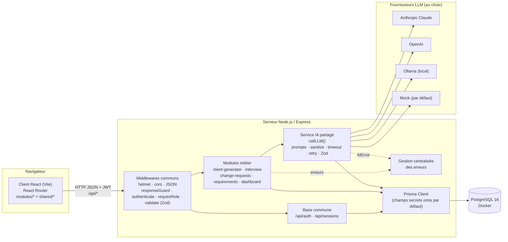
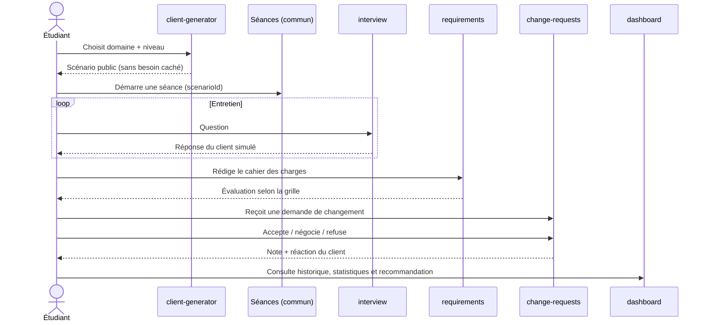
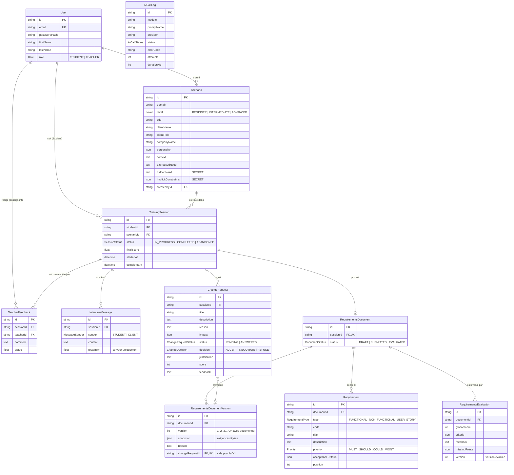
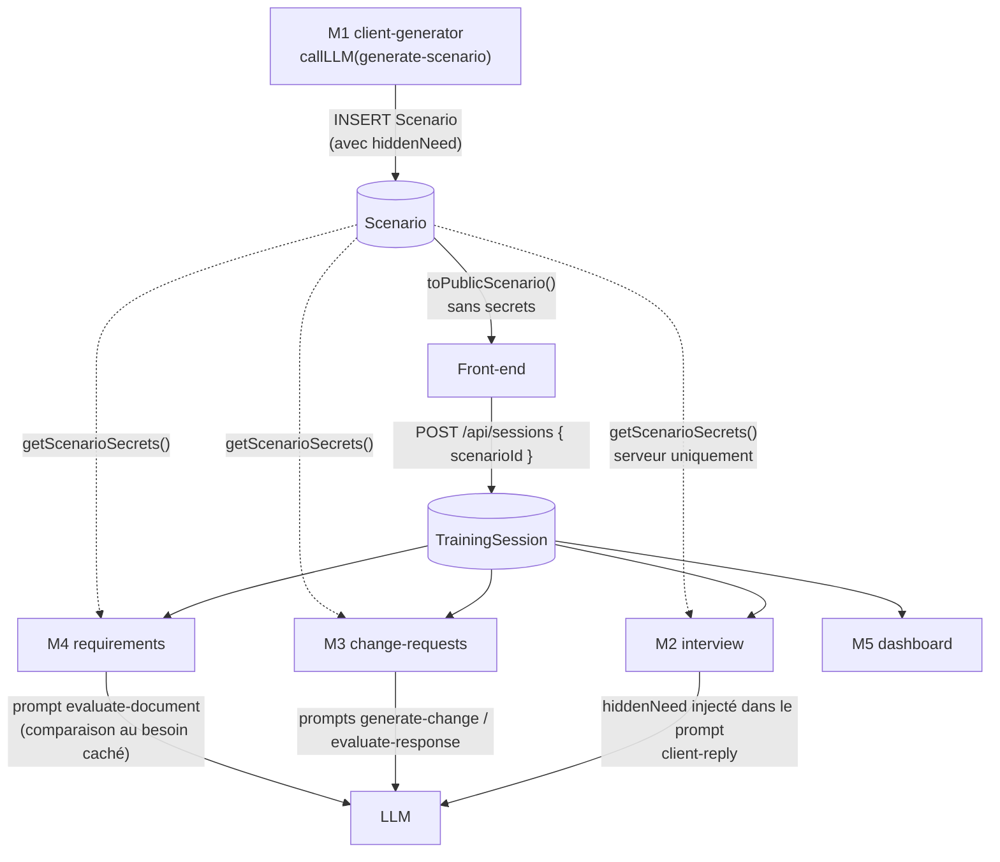
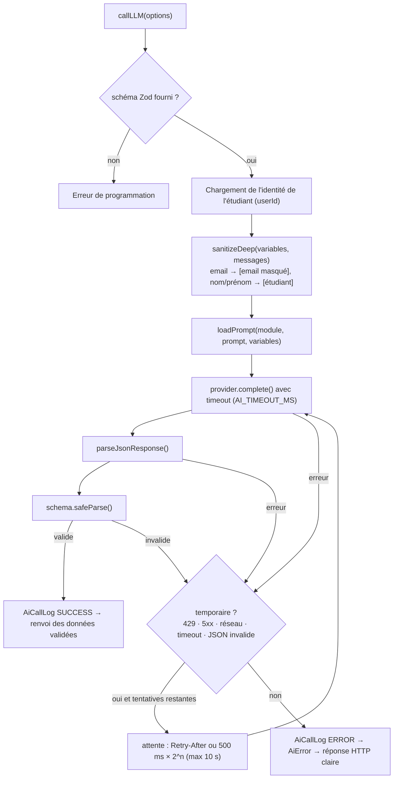
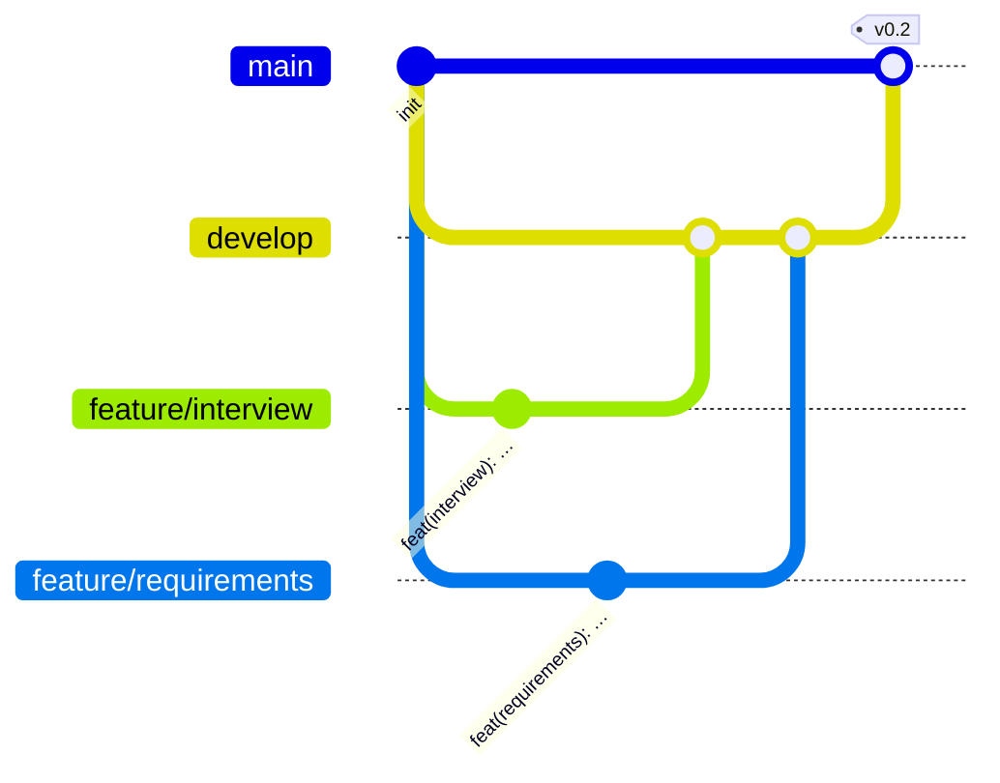

# Architecture technique — « Le Client Infernal »

> Document de référence de l'équipe, réutilisable dans le rapport technique.
> ESPRIT — module « IA for Software Engineering » — A.U 2026-2027.

## Sommaire

1. [Vue d'ensemble](#1-vue-densemble)
2. [Arborescence du dépôt](#2-arborescence-du-dépôt)
3. [Modèle de données](#3-modèle-de-données)
4. [Contrat d'API](#4-contrat-dapi)
5. [Service IA partagé](#5-service-ia-partagé)
6. [Sécurité et contraintes obligatoires](#6-sécurité-et-contraintes-obligatoires)
7. [Conventions Git et travail en parallèle](#7-conventions-git-et-travail-en-parallèle)

---

## 1. Vue d'ensemble



### Les couches

| Couche | Technologie | Rôle |
|---|---|---|
| **Présentation** | React 19 + Vite + React Router 7 | Interface en français. `shared/` contient le layout, l'authentification, le client HTTP et les composants communs. Chaque module a ses pages et ses appels API dans `modules/<module>/`. En développement, Vite redirige `/api` vers le serveur (proxy). |
| **API** | Express 5 | Routes REST sous `/api`. Les middlewares communs s'appliquent à tout : sécurité HTTP (helmet), CORS, analyse du JSON, `responseGuard` (filtre des secrets), authentification JWT, contrôle des rôles et validation Zod des entrées. |
| **Métier** | Services des modules | Chaque module suit le découpage `routes → controller → service`. Le controller ne fait que lire `req.valid` et renvoyer la réponse. La logique métier et les accès aux données sont dans le service. |
| **Service IA** | `server/src/shared/ai/` | Point d'entrée unique vers les LLM (voir §5). Il charge les prompts depuis des fichiers, masque les données personnelles, applique timeout et nouvelles tentatives, valide la réponse avec Zod et journalise chaque appel. |
| **Accès aux données** | Prisma 6 | Un seul client Prisma, configuré pour omettre par défaut les champs secrets du scénario. Le schéma et les migrations sont versionnés. |
| **Persistance** | PostgreSQL 16 (Docker) | Une base locale par développeur (`docker compose up`), port 5434 par défaut. |
| **Fournisseur LLM** | Claude / OpenAI / Ollama / Mock | Choisi par la variable `AI_PROVIDER`. Le mock fonctionne sans clé API ni réseau : chaque module fournit ses réponses simulées. |

### Parcours d'un étudiant



---

## 2. Arborescence du dépôt

Légende : **[COMMUN]** base commune (modification à signaler à toute l'équipe), **[M1]** à **[M5]** propriété du module.

```
.
├── CLAUDE.md                         [COMMUN] contexte du projet pour Claude Code
├── README.md                         [COMMUN]
├── package.json                      [COMMUN] workspaces npm + scripts
├── docker-compose.yml                [COMMUN] PostgreSQL local
├── scripts/
│   ├── setup.mjs                     [COMMUN] installation complète
│   ├── export-images.mjs             [COMMUN] export de pages HTML en PNG (maquettes, diagrammes)
│   ├── export-diagrams.mjs           [COMMUN] export des diagrammes Mermaid de ce document
│   └── rapport/generer-rapport.cjs   [COMMUN] génération du rapport Word (npm run rapport)
├── docs/
│   ├── ARCHITECTURE.md               [COMMUN] ce document
│   ├── ui/
│   │   ├── CHARTE.md                 [COMMUN] charte graphique et principes UX
│   │   └── maquettes/                [COMMUN] maquettes HTML des écrans + png/
│   ├── rapport/                      rapport Word (généré), sections/5.x-<module>.md [M1..M5], captures/, images/
│   ├── GUIDE_EQUIPE.md               [COMMUN] méthode de travail de l'équipe avec l'IA
│   └── prompts/                      journaux des prompts : JOURNAL.md [COMMUN] + <module>.md [M1..M5], modeles/
│
├── server/
│   ├── .env.example                  [COMMUN]
│   ├── prisma/
│   │   ├── schema.prisma             [COMMUN*] tables communes + tables des modules
│   │   ├── migrations/               [COMMUN*]
│   │   └── seed.js                   [COMMUN] données de démonstration
│   ├── tests/                        [COMMUN] tests du service IA et du besoin caché
│   └── src/
│       ├── index.js · app.js         [COMMUN] démarrage et assemblage Express
│       ├── config/env.js             [COMMUN] variables d'environnement validées (Zod)
│       ├── shared/                   [COMMUN]
│       │   ├── ai/                   service IA (callLLM, fournisseurs, prompts, sanitize)
│       │   ├── auth/                 inscription, connexion, /me (JWT + bcrypt)
│       │   ├── sessions/             séances d'entraînement (TrainingSession)
│       │   ├── db/                   client Prisma, getScenarioSecrets()
│       │   ├── errors/               AppError, gestionnaire d'erreurs
│       │   ├── middleware/           authenticate, requireRole, validate, responseGuard
│       │   └── serializers/          toPublicScenario()
│       └── modules/
│           ├── index.js              [COMMUN] registre des modules (aucune modification nécessaire)
│           ├── client-generator/     [M1] Khalil Abdelmoumen
│           ├── interview/            [M2] Kenza Baccar
│           ├── change-requests/      [M3] Ismail Ismail
│           ├── requirements/         [M4] Nadhem Hmida
│           └── dashboard/            [M5] Aziz Louati
│               ├── index.js                  exporte { name, router }
│               ├── <module>.routes.js        routes Express
│               ├── <module>.controller.js    lecture de la requête / envoi de la réponse
│               ├── <module>.service.js       logique métier + Prisma + callLLM
│               ├── <module>.schemas.js       schémas Zod (entrées HTTP + sorties LLM)
│               ├── prompts/*.md              prompts système (jamais en dur dans le code)
│               ├── mocks/*.mock.js           réponses simulées pour le fournisseur mock
│               └── README.md                 travail à réaliser
│
└── client/
    ├── vite.config.js · index.html   [COMMUN]
    └── src/
        ├── main.jsx · App.jsx        [COMMUN]
        ├── styles.css                [COMMUN]
        ├── shared/                   [COMMUN]
        │   ├── api/                  http.js (client HTTP), sessions.js
        │   ├── auth/                 AuthContext, ProtectedRoute
        │   ├── layout/               Layout (en-tête + menu)
        │   ├── components/           Loader, ErrorMessage, SessionPicker
        │   └── pages/                Login, Register, Home, NotFound
        └── modules/
            ├── index.js              [COMMUN] registre des modules
            └── <module>/             [M1..M5]
                ├── routes.jsx        libellé du menu, rôles, routes du module
                ├── api.js            appels à l'API du module
                ├── pages/            pages du module
                └── components/       composants du module
```

\* `schema.prisma` contient déjà les tables de tous les modules. Un responsable peut faire évoluer **ses** tables, à condition de créer une migration et de prévenir l'équipe (voir §7).

---

## 3. Modèle de données



### Propriétaire de chaque table

| Table | Propriétaire | Écrit par | Lu par |
|---|---|---|---|
| `User` | Base commune | auth | tous |
| `TrainingSession` | Base commune | sessions (commun) | M2, M3, M4, M5 |
| `AiCallLog` | Base commune (service IA) | service IA | M5 |
| `Scenario` | **M1** client-generator | M1, seed | M2, M3, M4 (via `getScenarioSecrets`), M5 |
| `InterviewMessage` | **M2** interview | M2 | M4 (contexte d'évaluation, optionnel), M5 |
| `ChangeRequest` | **M3** change-requests | M3 | M4 (vérifie la demande avant une nouvelle version), M5 |
| `RequirementsDocument`, `Requirement`, `RequirementsEvaluation` | **M4** requirements | M4 | M3 (contexte, optionnel), M5 |
| `RequirementsDocumentVersion` | **M4** requirements | M4 | M3 (versions créées suite à ses demandes), M5 |
| `TeacherFeedback` | **M5** dashboard | M5 | M5 |

Règle : **un module n'écrit que dans ses propres tables**. Il peut lire celles des autres.

### Circulation du scénario



1. **M1** génère le scénario. La sortie du LLM est validée par `generatedScenarioSchema`, puis enregistrée. L'API ne renvoie que `toPublicScenario(scenario)`.
2. L'étudiant démarre une **séance** (`TrainingSession`). C'est l'identifiant `sessionId` qui relie tous les modules.
3. **M2, M3 et M4** retrouvent le scénario via `session.scenarioId`. Pour construire leurs prompts, ils lisent le besoin caché avec `getScenarioSecrets()`. Le besoin caché part donc vers le LLM, mais jamais vers le navigateur.
4. **M5** agrège les données de toutes les tables en lecture seule.

---

## 4. Contrat d'API

Conventions :

- Préfixe `/api`, JSON en entrée et en sortie.
- Authentification : en-tête `Authorization: Bearer <jwt>`.
- Format d'erreur unique : `{ "error": { "code": "…", "message": "…", "details"?: [{ "path", "message" }] } }`.
- Codes d'erreur : `VALIDATION_ERROR` (400), `UNAUTHORIZED` / `INVALID_TOKEN` / `INVALID_CREDENTIALS` (401), `FORBIDDEN` (403), `NOT_FOUND` / `ROUTE_NOT_FOUND` (404), `CONFLICT` / `SCENARIO_IN_USE` (409), `AI_RATE_LIMIT` (429), `INTERNAL_ERROR` / `AI_PROMPT_ERROR` (500), `AI_INVALID_RESPONSE` / `AI_PROVIDER_ERROR` (502), `AI_MISSING_KEY` / `DATABASE_UNAVAILABLE` (503), `AI_TIMEOUT` (504).

Statut : ✅ implémenté (exemple fonctionnel), 🔲 prévu (à implémenter par le responsable du module).

### Base commune

| | Méthode | Route | Rôle | Requête | Réponse |
|---|---|---|---|---|---|
| ✅ | GET | `/api/health` | public | — | `{ status, database, ai: { provider, model } }` |
| ✅ | POST | `/api/auth/register` | public | `{ firstName, lastName, email, password }` | `201 { token, user }` (rôle STUDENT) |
| ✅ | POST | `/api/auth/login` | public | `{ email, password }` | `{ token, user }` |
| ✅ | GET | `/api/auth/me` | connecté | — | `{ user }` |
| ✅ | GET | `/api/sessions` | connecté | — | `{ sessions: [...] }` (étudiant : les siennes ; enseignant : toutes) |
| ✅ | POST | `/api/sessions` | STUDENT | `{ scenarioId }` | `201 { session }` |
| ✅ | GET | `/api/sessions/:sessionId` | propriétaire ou TEACHER | — | `{ session }` (avec scénario public) |
| ✅ | PATCH | `/api/sessions/:sessionId/status` | STUDENT propriétaire | `{ status: "COMPLETED" \| "ABANDONED" }` | `{ session }` |

### M1 — client-generator (`/api/client-generator`)

| | Méthode | Route | Rôle | Requête | Réponse |
|---|---|---|---|---|---|
| ✅ | GET | `/options` | connecté | — | `{ domains, levels, personalities }` (domaines suggérés, niveaux, profils de personnalité) |
| ✅ | POST | `/scenarios` | connecté | `{ domain, level, personality? }` (profil ou `RANDOM`, par défaut) | `201 { scenario }` (public, `personality.profile` renseigné) |
| ✅ | GET | `/scenarios?domain=&level=&personality=` | connecté | — | `{ scenarios: [...] }` |
| ✅ | GET | `/scenarios/:scenarioId` | connecté | — | `{ scenario }` |
| ✅ | DELETE | `/scenarios/:scenarioId` | TEACHER | — | `204` ; `409 SCENARIO_IN_USE` si des séances utilisent le scénario |

### M2 — interview (`/api/interview`)

| | Méthode | Route | Rôle | Requête | Réponse |
|---|---|---|---|---|---|
| ✅ | GET | `/sessions/:sessionId/messages` | propriétaire ou TEACHER | — | `{ messages: [{ id, sender, content, createdAt }] }` |
| ✅ | POST | `/sessions/:sessionId/messages` | STUDENT propriétaire | `{ content }` | `201 { studentMessage, clientMessage }` |
| 🔲 | POST | `/sessions/:sessionId/end` | STUDENT propriétaire | — | `{ summary }` (synthèse de l'entretien) |
| 🔲 | GET | `/sessions/:sessionId/progress` | propriétaire ou TEACHER | — | `{ questionsCount, discoveryLevel }` |

### M3 — change-requests (`/api/change-requests`)

| | Méthode | Route | Rôle | Requête | Réponse |
|---|---|---|---|---|---|
| ✅ | GET | `/sessions/:sessionId` | propriétaire ou TEACHER | — | `{ changeRequests: [...] }` |
| ✅ | POST | `/sessions/:sessionId/generate` | STUDENT propriétaire | — | `201 { changeRequest }` |
| 🔲 | POST | `/:changeRequestId/respond` | STUDENT propriétaire | `{ decision, justification }` | `{ changeRequest, clientReaction }` |

### M4 — requirements (`/api/requirements`)

| | Méthode | Route | Rôle | Requête | Réponse |
|---|---|---|---|---|---|
| ✅ | GET | `/sessions/:sessionId/document` | propriétaire ou TEACHER | — | `{ document: { status, currentVersion, requirements, evaluations (la dernière) } }` |
| ✅ | PUT | `/sessions/:sessionId/document` | STUDENT propriétaire | `{ requirements: [{ type, code, title, description, priority, acceptanceCriteria? }] }` | `{ document }` ; `409` si le document n'est plus un brouillon |
| ✅ | POST | `/sessions/:sessionId/document/submit` | STUDENT propriétaire | — | `{ document }` (statut SUBMITTED, version 1) ; `409` si déjà soumis |
| ✅ | POST | `/sessions/:sessionId/document/evaluate` | STUDENT propriétaire | — | `201 { evaluation }` (version courante) ; `409` si brouillon ou version déjà évaluée |
| ✅ | GET | `/sessions/:sessionId/document/evaluations` | propriétaire ou TEACHER | — | `{ evaluations: [...] }` (la plus récente d'abord) |
| ✅ | POST | `/sessions/:sessionId/document/versions` | STUDENT propriétaire | `{ changeRequestId, reason, requirements }` | `201 { version }` (V N+1, document SUBMITTED) ; `404` demande d'une autre séance ; `409` demande non acceptée/négociée ou déjà utilisée |
| ✅ | GET | `/sessions/:sessionId/document/versions?changeRequestId=` | propriétaire ou TEACHER | — | `{ versions: [{ version, reason, changeRequest, requirementsCount, globalScore, createdAt }] }` |
| ✅ | GET | `/sessions/:sessionId/document/versions/:version` | propriétaire ou TEACHER | — | `{ version: { …, snapshot: [...] } }` |

Cycle de vie : `DRAFT` → submit → `SUBMITTED` (V1) → evaluate → `EVALUATED` ; une demande de changement acceptée ou négociée (module 3) permet `POST /versions` → `SUBMITTED` (V N+1), qui peut à nouveau être évaluée. Côté interface, le module 3 ouvre `/requirements?session=<id>&changeRequest=<id>`.

### M5 — dashboard (`/api/dashboard`)

| | Méthode | Route | Rôle | Requête | Réponse |
|---|---|---|---|---|---|
| ✅ | GET | `/me/stats` | STUDENT | — | `{ stats }` |
| ✅ | GET | `/teacher/overview` | TEACHER | — | `{ overview: { counts, aiCalls, recentSessions } }` |
| 🔲 | GET | `/me/history` | STUDENT | — | `{ sessions: [...] }` (avec notes) |
| 🔲 | GET | `/me/recommendation` | STUDENT | — | `{ recommendation: { domain, level, focusSkill, rationale } }` |
| 🔲 | GET | `/teacher/students/:studentId` | TEACHER | — | `{ student, sessions }` |
| 🔲 | POST | `/teacher/sessions/:sessionId/feedback` | TEACHER | `{ comment, grade? }` | `201 { feedback }` |

---

## 5. Service IA partagé

Emplacement : `server/src/shared/ai/`.

```
ai/
├── index.js          callLLM(), createAiClient(), getAiInfo()
├── errors.js         AiError + table des codes / statuts HTTP / messages
├── promptLoader.js   lecture de modules/<module>/prompts/<nom>.md, variables {{x}}
├── sanitize.js       masquage du nom, du prénom et de l'email de l'étudiant
├── parseJson.js      extraction du JSON (y compris dans un bloc ```json)
└── providers/
    ├── index.js      choix du fournisseur selon AI_PROVIDER
    ├── http.js       POST commun + traduction 429 / 401 / 5xx en AiError
    ├── claude.js     API Messages d'Anthropic
    ├── openai.js     Chat Completions (response_format JSON)
    ├── ollama.js     /api/chat local (format JSON)
    └── mock.js       charge modules/<module>/mocks/<prompt>.mock.js
```

### Utilisation dans un module

```js
import { callLLM } from '../../shared/ai/index.js';
import { clientReplySchema } from './interview.schemas.js';

const result = await callLLM({
  module: 'interview',            // dossier du module
  prompt: 'client-reply',         // → modules/interview/prompts/client-reply.md
  variables: { clientName, hiddenNeed /* … */ },   // remplace les {{variables}}
  messages: [{ role: 'user', content: 'Bonjour…' }], // historique éventuel
  schema: clientReplySchema,      // OBLIGATOIRE
  userId: req.user.id,            // pour masquer l'identité de l'étudiant
});
// result est un objet déjà validé par Zod
```

### Déroulement d'un appel



### Choix du fournisseur (`server/.env`)

| `AI_PROVIDER` | Comportement |
|---|---|
| `auto` (défaut) | `claude` si `ANTHROPIC_API_KEY` est définie, sinon `openai` si `OPENAI_API_KEY` est définie, sinon **`mock`** |
| `mock` | Réponses simulées, sans réseau ni clé |
| `claude` | Modèle `AI_MODEL` (par défaut `claude-sonnet-5-5`), clé `ANTHROPIC_API_KEY` |
| `openai` | Modèle `AI_MODEL` (par défaut `gpt-4o-mini`), clé `OPENAI_API_KEY` |
| `ollama` | Modèle `AI_MODEL` (par défaut `llama3.1`), serveur `OLLAMA_BASE_URL` |

Autres réglages : `AI_TIMEOUT_MS` (30 000 par défaut) et `AI_MAX_RETRIES` (2 par défaut, donc 3 essais au maximum).

### Erreurs gérées

| Code | HTTP | Cas | Nouvelle tentative |
|---|---|---|---|
| `AI_TIMEOUT` | 504 | pas de réponse dans le délai | oui |
| `AI_RATE_LIMIT` | 429 | quota dépassé | oui (respecte `Retry-After`) |
| `AI_MISSING_KEY` | 503 | clé absente (fournisseur imposé sans clé) ou refusée (401/403) | non |
| `AI_INVALID_RESPONSE` | 502 | réponse vide, pas du JSON, ou JSON non conforme au schéma | oui |
| `AI_PROVIDER_ERROR` | 502 | fournisseur injoignable (oui), erreur 5xx (oui), erreur 4xx (non), mock manquant (non) | selon le cas |
| `AI_PROMPT_ERROR` | 500 | fichier de prompt introuvable ou variable `{{x}}` manquante | non |

### Prompts et mocks

- Les **prompts système** sont dans `server/src/modules/<module>/prompts/<nom>.md`. Les commentaires `<!-- … -->` en tête de fichier documentent le prompt (variables, version, responsable) et sont retirés avant l'envoi.
- Les **mocks** sont dans `server/src/modules/<module>/mocks/<nom>.mock.js`. Ils exportent une fonction `({ variables, messages }) => objet` qui doit respecter le même schéma Zod que la vraie réponse.
- Toute modification d'un prompt est tracée dans le journal du module, `docs/prompts/<module>.md`.

---

## 6. Sécurité et contraintes obligatoires

| Contrainte | Mise en œuvre |
|---|---|
| Aucune donnée personnelle envoyée au LLM | Les prompts ne reçoivent que des données de scénario et des messages. `callLLM` masque en plus l'email, le nom et le prénom de l'étudiant dans tout ce qui part vers le fournisseur (test automatisé : `tests/ai.test.js`). `AiCallLog` ne stocke aucun contenu. |
| Sortie du LLM validée par Zod | Le paramètre `schema` est obligatoire dans `callLLM`, et la donnée renvoyée est `result.data` du `safeParse`. |
| Erreurs du LLM gérées | Timeout, 429, clé absente et réponse invalide sont traduits en `AiError`, avec un statut HTTP et un message en français (voir §5). |
| Le besoin caché ne quitte pas le serveur | Trois protections : (1) Prisma omet `hiddenNeed` et `implicitConstraints` par défaut ; (2) les services renvoient `toPublicScenario()` ; (3) le middleware `responseGuard` retire ces champs de toute réponse JSON et écrit une alerte dans la console (tests : `tests/hidden-need.test.js`). |
| Mots de passe | Hachés avec bcrypt (10 tours). `passwordHash` n'est jamais renvoyé (`toPublicUser`). |
| Rôles | `authenticate` + `requireRole('TEACHER')`. L'inscription crée toujours un STUDENT ; les comptes enseignants sont créés par le seed ou par un administrateur. |
| Entrées | Toutes les entrées HTTP sont validées par Zod (`validate`). |

> **Choix d'architecture à valider par l'équipe** : `implicitConstraints` est traité comme secret au même titre que `hiddenNeed`, car l'étudiant doit aussi découvrir ces contraintes pendant l'entretien. Pour l'exposer, il suffit de le retirer de `SECRET_SCENARIO_FIELDS` (`server/src/shared/serializers/scenario.js`).

---

## 7. Conventions Git et travail en parallèle

### Branches



| Branche | Rôle |
|---|---|
| `main` | Version stable, démontrable. Mise à jour uniquement par fusion de `develop`. |
| `develop` | Intégration. Les branches `feature/*` y sont fusionnées par pull request. |
| `feature/client-generator`, `feature/interview`, `feature/change-requests`, `feature/requirements`, `feature/dashboard` | Une branche par membre, créée depuis `develop`. |

### Commits conventionnels

Format : `type(portée): description en français`.

- Types : `feat`, `fix`, `docs`, `refactor`, `test`, `chore`, `style`.
- Portée : nom du module (`interview`, `requirements`, …) ou `core` pour la base commune, `prompts` pour un prompt.
- Exemples : `feat(interview): ajout de l'historique du chat`, `fix(core): gestion du 429 sans en-tête Retry-After`, `docs(prompts): v0.2 du prompt client-reply`.

La note individuelle dépend des commits. Faites des commits **petits, fréquents et à votre nom** (`git config user.name` et `user.email`).

### Travailler en parallèle sans conflit

1. **Un module ne touche que ses dossiers** : `server/src/modules/<module>/` et `client/src/modules/<module>/`.
2. **Brancher son module ne demande aucune modification commune** : les registres `server/src/modules/index.js` et `client/src/modules/index.js` sont déjà à jour. On ajoute ses routes dans ses propres fichiers `<module>.routes.js` et `routes.jsx`.
3. **Le fournisseur mock permet de travailler sans clé et sans attendre les autres** : chacun fait évoluer son mock en même temps que son prompt.
4. **Le seed fournit des données de toutes les tables**, donc chacun peut développer son module sans que les autres aient fini le leur.
5. **Base commune et schéma Prisma** : toute modification est signalée à l'équipe avant d'être fusionnée. Pour le schéma :
   ```bash
   npm run db:migrate -- --name ajout_champ_xxx   # crée la migration
   git add server/prisma && git commit -m "feat(requirements): ajout du champ xxx"
   ```
   Après un pull qui contient une nouvelle migration : `npm run db:deploy`.
6. **Synchronisation régulière** : `git pull origin develop` sur sa branche `feature/*` au moins une fois par jour.
7. **Traçabilité des prompts** : chaque demande faite à une IA est ajoutée dans le journal du module, `docs/prompts/<module>.md` (P-M<x>-NNN) ; les demandes communes vont dans `docs/prompts/JOURNAL.md`. Méthode complète : `docs/GUIDE_EQUIPE.md`.
