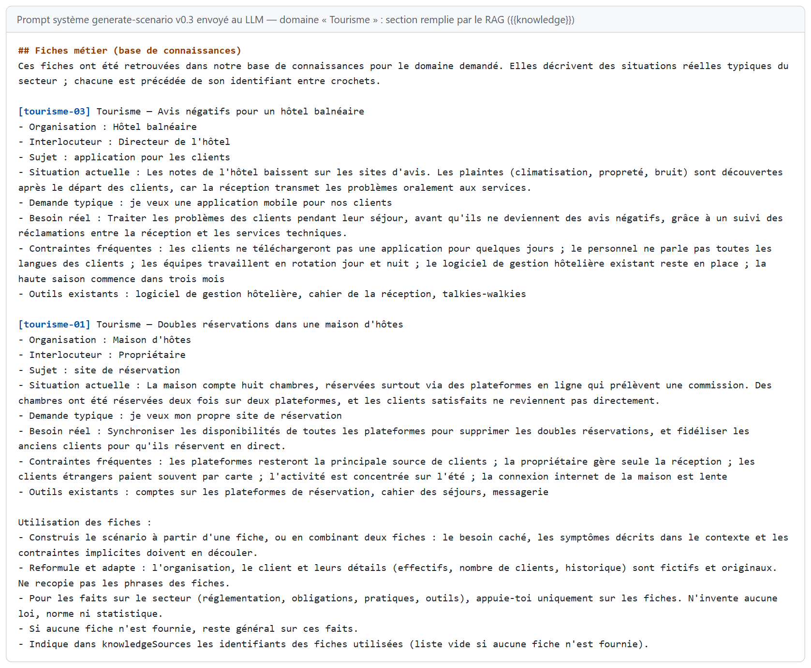
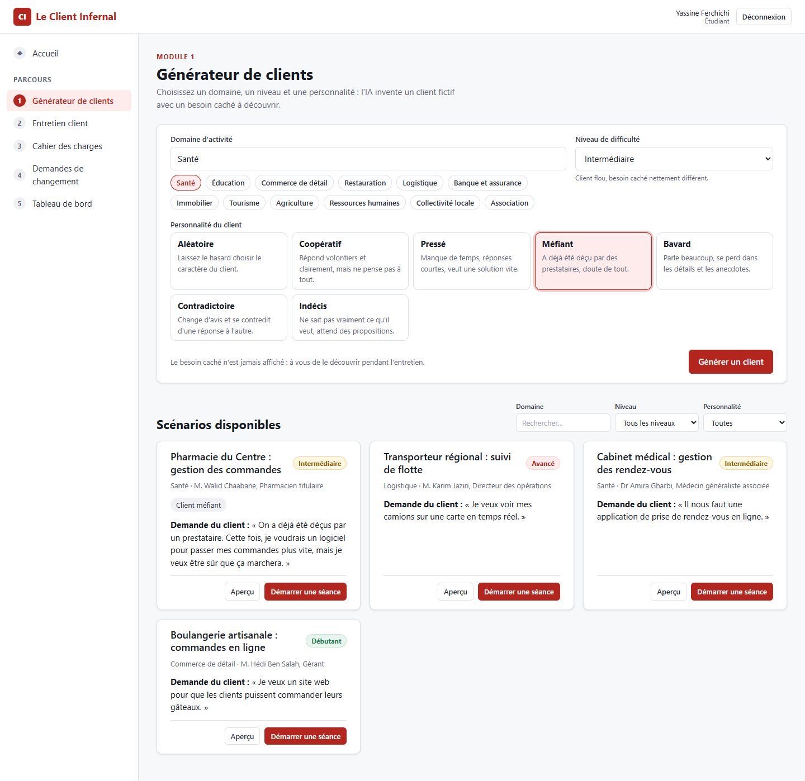
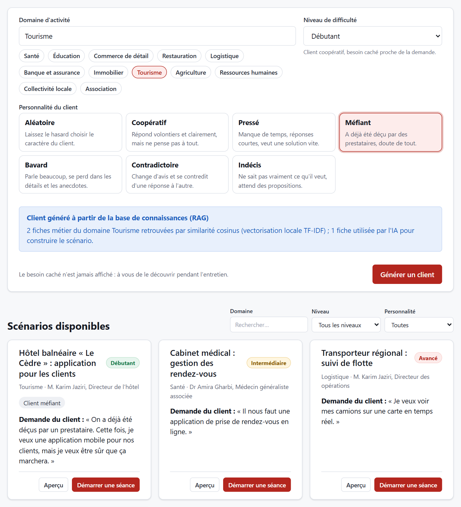
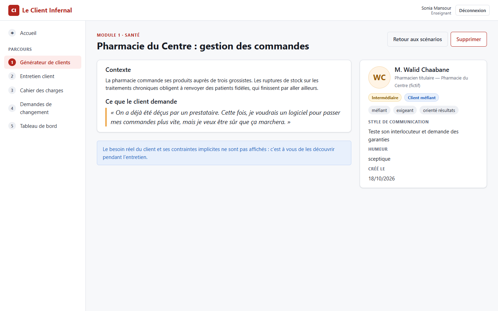
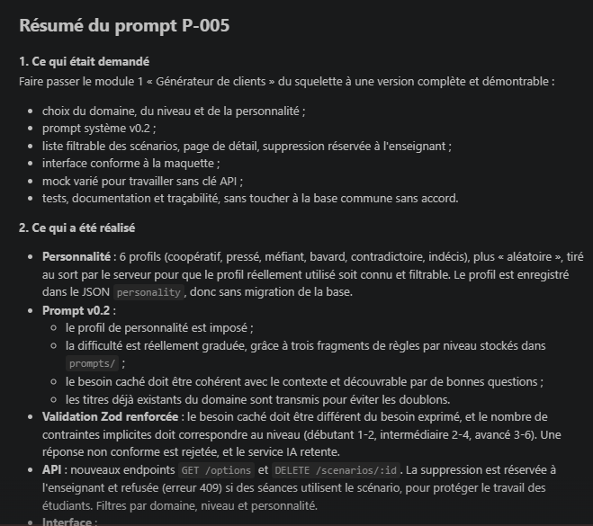
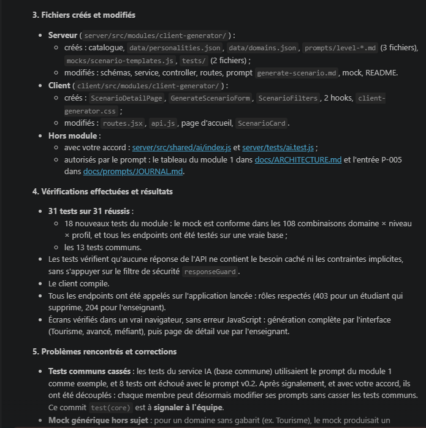

## 5.1 Module 1 — Générateur de clients

**Responsable :** Khalil Abdelmoumen · **Branche :** `feature/client-generator` · **Dossiers :** `server/src/modules/client-generator/`, `client/src/modules/client-generator/` · **Version :** 0.3

### Objectif et fonctionnalités

Le module 1 génère, grâce au LLM, le **scénario** sur lequel repose toute une séance : un client fictif, sa personnalité, le contexte de son organisation, ce qu'il demande (besoin exprimé), son vrai problème (besoin caché) et ses contraintes implicites. C'est la donnée d'entrée des modules 2, 3, 4 et 5.

| Fonctionnalité | Réalisation |
|---|---|
| Choix du domaine | Saisie libre et 12 domaines suggérés (santé, éducation, logistique…) |
| Choix du niveau | Débutant, intermédiaire, avancé, avec une description de chaque niveau |
| Choix de la personnalité | 6 profils (coopératif, pressé, méfiant, bavard, contradictoire, indécis) ou « aléatoire », tiré au sort par le serveur |
| Base de connaissances (RAG) | 12 fiches métier (une par domaine suggéré, 36 situations réelles typiques), retrouvées par similarité cosinus et injectées dans le prompt |
| Génération par l'IA | Prompt système v0.3, réponse validée par un schéma Zod dépendant du niveau et des fiches fournies |
| Stockage et consultation | Liste filtrable (domaine, niveau, personnalité), page de détail publique, état vide |
| Suppression | Réservée à l'enseignant ; refusée (409) si des séances utilisent le scénario |
| Mode sans clé API | Le mock lit les fiches injectées dans le prompt, comme le LLM ; vectorisation locale TF-IDF |
Tableau : Fonctionnalités du module 1

| Méthode | Route | Rôle | Rôle de l'endpoint |
|---|---|---|---|
| GET | /api/client-generator/options | connecté | Domaines suggérés, niveaux et profils de personnalité |
| POST | /api/client-generator/scenarios | connecté | Génère et enregistre un scénario ; renvoie sa version publique et un résumé du RAG (nombre de fiches, mode de vectorisation) |
| GET | /api/client-generator/scenarios | connecté | Liste filtrée par domaine, niveau et personnalité |
| GET | /api/client-generator/scenarios/:id | connecté | Détail public d'un scénario |
| DELETE | /api/client-generator/scenarios/:id | enseignant | Suppression (refusée si le scénario est utilisé) |
Tableau : Endpoints du module 1

Le profil de personnalité est stocké dans le champ JSON `personality` du scénario, et les fiches métier sont des fichiers Markdown du module : ces fonctionnalités ont été ajoutées **sans modifier le schéma de la base**, donc sans impact sur les autres modules.

### Prompts utilisés

Deux types de prompts interviennent dans ce module : les prompts de développement adressés à l'assistant (journal des prompts) et le prompt système utilisé par l'application elle-même pour générer les scénarios.

| Prompt | Type | Rôle |
|---|---|---|
| P-001 | Développement | Squelette du module et première version (v0.1) du prompt système |
| P-004 | Développement | Rédaction, avec l'IA, du prompt de développement du module |
| P-005 | Développement | Version complète du module (voir section 2.8) |
| P-014 | Développement | Lecture des cours et choix d'une technique du cours par membre (le RAG pour le module 1) |
| P-M1-001 | Développement | Réalisation du RAG : base de connaissances, recherche, prompt v0.3, interface, tests |
| generate-scenario.md | Système (application) | Génération d'un scénario au format JSON ; v0.1, v0.2 puis v0.3 |
| level-*.md (3 fichiers) | Système (fragments) | Règles de difficulté propres à chaque niveau, injectées dans le prompt principal |
Tableau : Prompts liés au module 1

| Aspect | v0.1 (P-001) | v0.2 (P-005) | v0.3 (P-M1-001) |
|---|---|---|---|
| Personnalité | Inventée librement par le LLM | Imposée : profil choisi et comportement attendu | Inchangée |
| Difficulté | Trois lignes génériques | Règles détaillées par niveau (fragments level-*.md) | Inchangée |
| Connaissances métier | Mémoire du LLM | Mémoire du LLM | Fiches de la base de connaissances retrouvées par le RAG ; aucune loi, norme ni statistique inventée |
| Besoin caché | Doit être découvrable | Doit découler du contexte, être découvrable et décrire son impact | Construit à partir d'une situation réelle typique du secteur |
| Doublons | Non gérés | Titres existants du domaine fournis au LLM | Titres existants et fiches déjà exploitées écartées (MMR) |
| Validation Zod | Format seul | Besoin caché différent du besoin exprimé ; nombre de contraintes conforme au niveau | Sources citées : uniquement des fiches fournies, au moins une |
Tableau : Évolution du prompt système du module 1

Si la réponse du LLM ne respecte pas ces règles, elle est rejetée par Zod et le service IA partagé relance automatiquement l'appel : la qualité est garantie par le code, pas seulement par la formulation du prompt.

### Technique d'IA du cours appliquée

**Technique : RAG (Retrieval-Augmented Generation)**, cours « Adaptation et optimisation des LLMs et intégration d'une API IA » (Séance 4, diapositives 26 à 31). Avant de répondre, le modèle reçoit les passages pertinents d'une base documentaire : c'est « l'examen à livre ouvert ». Le cours « Prompt Engineering » décrit la même idée sous le nom de **Knowledge generation** (p. 18) : intégrer des connaissances externes aux connaissances internes du modèle, sans fine-tuning.

**Problème résolu.** Sans connaissance du métier, le LLM produit des scénarios génériques et peut halluciner, par exemple citer une réglementation qui n'existe pas (risque « hallucination » du cours, p. 31). Les scénarios d'un même domaine finissent aussi par se ressembler. Le fine-tuning n'était pas envisageable : il faut un GPU et un jeu de données d'entraînement. Le RAG, lui, s'enrichit en modifiant simplement des fichiers Markdown, sans réentraîner le modèle.

| Étape du cours | Réalisation dans le module | Fichier |
|---|---|---|
| 1. Découpage | 12 fiches métier (36 situations : organisation, interlocuteur, situation actuelle, demande typique, besoin réel, contraintes, outils) découpées en blocs, avec chevauchement si une situation dépasse 220 mots | `knowledge/*.md`, `rag/knowledgeBase.js` |
| 2. Vectorisation | Embeddings du fournisseur IA par le service partagé (OpenAI, Ollama) ; à défaut, vectorisation locale TF-IDF | `shared/ai/embeddings.js`, `rag/vectorizer.js` |
| 3. Recherche | Similarité cosinus entre le domaine demandé et chaque bloc, seuil de pertinence, puis top-2 diversifié (MMR) | `rag/similarity.js`, `rag/retriever.js` |
| 4. Génération | Blocs insérés dans le prompt v0.3 avec leur identifiant ; le LLM cite ses sources (`knowledgeSources`), vérifiées par Zod | `prompts/generate-scenario.md`, `client-generator.schemas.js` |
Tableau : Le pipeline RAG du cours appliqué au module 1

La recherche utilise la formule du cours, `cos(θ) = (A · B) / (‖A‖ ‖B‖)`. Le module y ajoute une sélection **MMR** (Maximal Marginal Relevance). Parmi les blocs pertinents, il retient d'abord celui qui ressemble le moins aux scénarios déjà enregistrés dans le domaine. Chaque nouvelle génération exploite ainsi une autre situation du secteur. Le prompt suit la construction recommandée par le cours (diapositive 30) : un contexte (les fiches), une tâche, et une instruction de s'appuyer uniquement sur ce contexte pour les faits du secteur.

| Domaine Tourisme (mode simulé) | Sans RAG (v0.2) | Avec RAG (v0.3) |
|---|---|---|
| Titre | Groupe Horizon Tourisme : centralisation des données | Hôtel balnéaire « Le Cèdre » : application pour les clients |
| Contexte | Organisation du secteur « Tourisme » qui gère ses activités avec des fichiers Excel | Les notes de l'hôtel baissent sur les sites d'avis ; les plaintes sont découvertes après le départ des clients |
| Besoin caché | Une source unique de vérité pour mettre fin aux conflits sur les chiffres (générique) | Traiter les problèmes des clients pendant leur séjour, avant qu'ils ne deviennent des avis négatifs |
| Contraintes implicites | Génériques (utilisateurs peu à l'aise avec l'informatique, aucune licence payante) | Propres au secteur (équipes en rotation jour et nuit, haute saison, logiciel hôtelier existant) |
Tableau : Avant / après le RAG pour un même domaine

**Diversité vérifiée dans l'application.** La base de démonstration contenait déjà un scénario de cabinet médical. Deux générations successives dans le domaine Santé ont donné une pharmacie, puis un laboratoire d'analyses : le RAG a écarté la situation déjà exploitée. Une troisième génération, une fois les trois situations de la fiche exploitées, en a réutilisé une. Pour un domaine absent de la base (Aéronautique), aucune fiche n'est retenue et le prompt demande au LLM de rester général sur les faits du secteur.

**Sécurité.** Les fiches décrivent des besoins réels typiques : elles restent sur le serveur. Le front-end ne reçoit que le nombre de fiches retrouvées et utilisées, leur domaine et le mode de vectorisation. Les embeddings passent par le service IA partagé, avec les mêmes garanties que `callLLM` : timeout, nouvelles tentatives, validation Zod des vecteurs, journalisation sans contenu. Seuls des textes métier fictifs sont vectorisés, jamais de données personnelles. Si le fournisseur d'embeddings échoue, le module bascule sur la vectorisation locale pendant cinq minutes au lieu de bloquer la génération.

### Réalisation et captures

L'interface suit la maquette 03 du chapitre 4 et la charte graphique. Le formulaire présente les profils de personnalité sous forme de cartes de choix ; la liste propose des filtres et un état vide ; la fiche du scénario n'affiche que les informations publiques et rappelle que le besoin réel est à découvrir pendant l'entretien. Depuis la v0.3, un encadré indique après chaque génération l'apport du RAG, sans jamais révéler le contenu des fiches.

Par rapport à la maquette, l'écran réalisé ajoute le choix de la personnalité, les filtres demandés par le tableau officiel du projet et l'encadré du RAG ; la structure (en-tête, formulaire, cartes de scénarios, badges de niveau) est conservée.

### Tests

Le module est couvert par **35 tests automatisés** (18 avant le RAG), exécutés avec les 23 tests de la base commune :

- validation des schémas : profil inconnu refusé, besoin caché identique au besoin exprimé refusé, nombre de contraintes contrôlé pour chaque niveau, source inventée ou absente refusée ;
- base de connaissances : une fiche par domaine suggéré, format complet de chaque situation (8 champs, 5 contraintes), identifiants uniques ;
- découpage avec chevauchement, normalisation des mots, similarité cosinus, TF-IDF et MMR testés sur des exemples connus ;
- recherche : chaque domaine suggéré retrouve ses propres fiches, un domaine inconnu n'en retrouve aucune, une situation déjà exploitée est écartée ;
- embeddings : vectorisation des blocs une seule fois, repli local si le fournisseur échoue, erreur de programmation non masquée ; côté base commune, 10 tests du service d'embeddings (choix du fournisseur, validation, 429, timeout, format des requêtes OpenAI et Ollama) ;
- réponses simulées conformes au schéma pour les **216 combinaisons** domaine × niveau × personnalité construites à partir des fiches, en plus des 108 combinaisons du mode sans fiche ;
- construction du prompt v0.3 sans variable manquante ;
- endpoints testés sur une vraie base : authentification, validation, filtres, rôles, refus de suppression (409), résumé du RAG sans contenu ni identifiant de fiche, et **absence du besoin caché et des contraintes implicites dans toutes les réponses**, sans compter sur le filtre de sécurité.

### Difficultés et apport de l'IA

- **Couplage caché entre tests** : des tests de la base commune utilisaient le prompt du module 1 comme exemple et ont échoué avec la v0.2. L'IA a demandé l'accord du chef de projet avant de toucher au code partagé, puis a découplé les tests : chaque membre peut désormais faire évoluer ses prompts sans casser les tests communs.
- **Mode simulé peu crédible** : pour un domaine sans gabarit dédié (ex. Tourisme), la réponse simulée ne mentionnait pas le domaine. Le défaut a été repéré en vérifiant l'écran dans un navigateur, puis corrigé. La v0.3 règle le problème à la source : les 12 domaines suggérés ont désormais leurs fiches.
- **Calibrage de la recherche** : l'IA a mesuré les scores de similarité de chaque domaine avant de fixer les seuils. Pour les domaines connus, les blocs des autres fiches ont un score nul ou presque (au plus 0,05, contre 0,17 à 0,51 pour les bons blocs) ; un domaine inconnu a un score nul partout.
- **Vérification visuelle** : la capture de l'écran, réalisée par l'IA dans un navigateur sans interface, a révélé deux défauts invisibles dans les tests : des guillemets imbriqués dans l'encadré, et des noms mal accordés à la fonction (« Mme … , Directeur »). Les deux ont été corrigés.
- **Base commune** : le service d'embeddings a été ajouté dans `server/src/shared/ai/` pour que tout appel à un fournisseur passe par le service partagé. La modification est signalée à l'équipe (P-M1-001).
- **Décisions humaines** : choix du RAG parmi les techniques du cours (P-014), refus de suppression d'un scénario utilisé, génération ouverte aux deux rôles, découplage des tests. Ces choix sont tracés dans le journal des prompts.

> À compléter : capture du prompt P-M1-001 et du résumé final de l'IA (p-m1-001-01-prompt.png).

### Limites et perspectives

- Le prompt système v0.3 n'a pas encore été évalué avec un vrai fournisseur (Claude ou OpenAI), faute de clé API. Les seuils de pertinence des embeddings (0,3 et 85 % du meilleur score) sont à recalibrer avec le modèle choisi.
- La vectorisation locale TF-IDF est lexicale : elle rapproche des textes qui partagent des mots, pas des synonymes. Par exemple, « Transport aérien » retrouve aussi une fiche du commerce de détail, qui mentionne une société de transport. C'est la limite des « distracteurs » décrite dans le cours ; de vrais embeddings la réduisent.
- La base compte 36 situations rédigées à la main : après trois générations dans un même domaine, les situations se répètent. Elle s'enrichit en ajoutant des sections aux fiches (`knowledge/README.md`).
- En mode simulé, le besoin caché reprend mot pour mot la fiche ; un vrai LLM le reformule.
- La liste n'est pas paginée.
> À compléter : après un test avec un vrai fournisseur, ajouter un exemple de scénario généré avec les embeddings et comparer sa qualité à celle du mode simulé.
