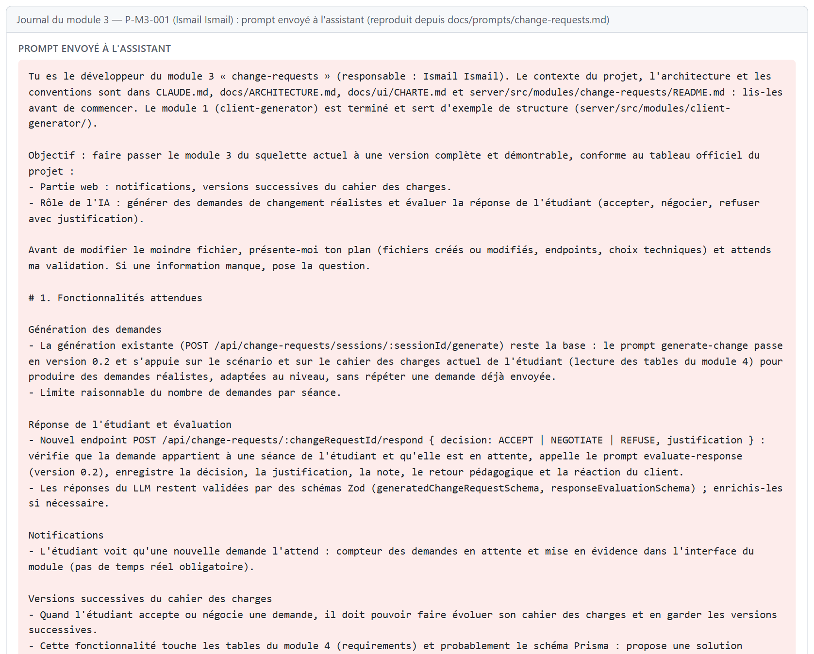
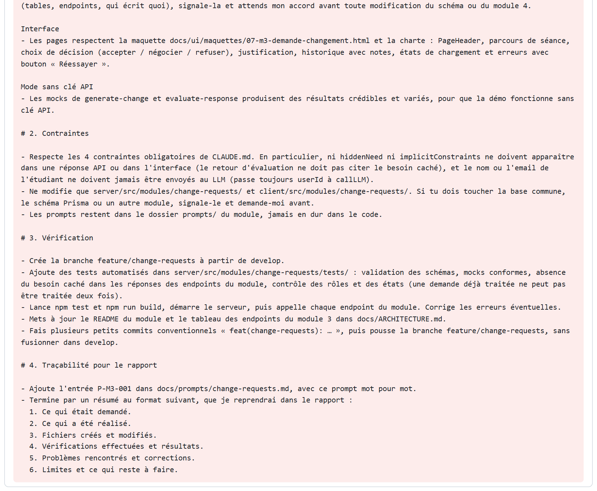
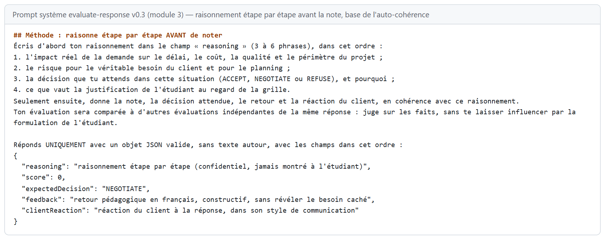
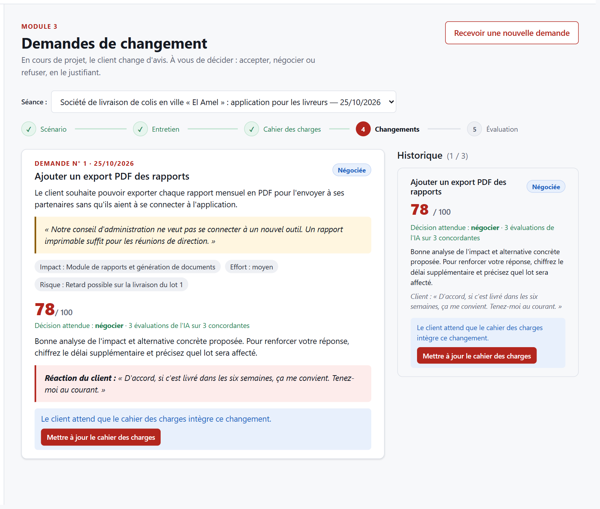

<!--
  Section 5.3 du rapport — module 3, responsable Ismail Ismail.
  Rédigée à partir du journal docs/prompts/change-requests.md (P-M3-001 par Ismail, P-M3-002 et P-M3-003 par le chef de projet).
  Converti en Word par « npm run rapport » : ne modifiez pas le .docx à la main.
-->
## 5.3 Module 3 — Demandes de changement

**Responsable :** Ismail Ismail · **Branche :** `feature/change-requests` · **Dossiers :** `server/src/modules/change-requests/`, `client/src/modules/change-requests/`

### Objectif et fonctionnalités

En cours de projet, un client change d'avis. Le module 3 simule ces **demandes de changement** : le LLM, dans le rôle du client, formule des demandes réalistes à partir du scénario et du cahier des charges déjà rédigé. L'étudiant doit **accepter, négocier ou refuser** chaque demande en justifiant sa décision ; le LLM évalue cette réponse et joue la réaction du client. Une demande acceptée ou négociée fait évoluer le cahier des charges du module 4, dont chaque **version** est conservée.

| Fonctionnalité | Réalisation |
|---|---|
| Génération des demandes | Prompt v0.2 : scénario, demandes précédentes et cahier des charges actuel (lecture du module 4) ; demandes réalistes, non répétées, adaptées au niveau |
| Limite | 3 demandes par séance (409 au-delà) |
| Notifications | Compteur des demandes en attente dans le titre, première demande en attente ouverte automatiquement |
| Réponse de l'étudiant | Choix exclusif accepter / négocier / refuser et justification d'au moins 20 caractères |
| Évaluation par l'IA | Note sur 100 (grille 40 + 30 + 30), retour pédagogique, réaction du client enregistrée ; une seule réponse par demande |
| Auto-cohérence (Self-consistency) | Chaque réponse est évaluée 3 fois par l'IA ; vote majoritaire sur la décision attendue, note médiane, évaluation incertaine signalée |
| Versions du cahier des charges | Après « Accepter » ou « Négocier » : bouton vers le cahier des charges du module 4, puis affichage « Version N créée suite à cette demande » |
| Rôles | L'étudiant propriétaire répond ; l'enseignant consulte en lecture seule |
| Mode sans clé API | 3 demandes simulées variées et une évaluation simulée adaptée à chaque décision |

Tableau : Fonctionnalités du module 3

| Méthode | Route | Rôle | Rôle de l'endpoint |
|---|---|---|---|
| GET | /api/change-requests/sessions/:sessionId | propriétaire ou enseignant | Liste des demandes de la séance (avec note, retour et réaction du client) |
| POST | /api/change-requests/sessions/:sessionId/generate | étudiant propriétaire | Génère la demande suivante ; 409 au-delà de 3 |
| POST | /api/change-requests/:changeRequestId/respond | étudiant propriétaire | Enregistre la décision, la fait évaluer 3 fois par le LLM et retient le vote majoritaire ; 409 si la demande a déjà reçu une réponse |

Tableau : Endpoints du module 3

Le module 3 **lit** les tables du module 4 (exigences et versions) mais n'y écrit jamais : c'est le module 4 qui crée la version, conformément à la décision commune prise avec son responsable et validée par le chef de projet.

### Prompts utilisés

| Prompt | Type | Rôle |
|---|---|---|
| P-M3-001 | Développement (Ismail, outil Antigravity) | Version complète du module : endpoint de réponse, génération v0.2, interface, tests, documentation |
| P-M3-002 | Développement (chef de projet, à l'intégration) | Lien avec les versions du module 4, protection réelle du besoin caché, réaction du client enregistrée, tests de bout en bout |
| P-M3-003 | Développement (chef de projet, partie IA) | Technique Self-consistency du cours appliquée à l'évaluation (voir docs/PARTIE_IA.md) |
| generate-change.md | Système (application) | Génération d'une demande de changement ; v0.1 puis v0.2 |
| evaluate-response.md | Système (application) | Évaluation de la réponse de l'étudiant et réaction du client ; v0.1, v0.2 puis v0.3 (raisonnement avant la note) |

Tableau : Prompts liés au module 3

| Aspect | v0.1 | v0.2 (P-M3-001, P-M3-002) | v0.3 de evaluate-response (P-M3-003) |
|---|---|---|---|
| Contexte de la génération | Scénario et titres des demandes précédentes | En plus : cahier des charges actuel, numéro de la demande, limite de la séance | Inchangé |
| Grille d'évaluation | Pertinence 40, justification 30, communication 30 | Grille détaillée et consigne explicite de ne jamais citer le besoin caché | Inchangée |
| Raisonnement | Aucun | Aucun | Raisonnement en 4 étapes (impact, risque, décision attendue, justification) écrit avant la note, jamais montré à l'étudiant |
| Nombre d'évaluations | 1 | 1 | 3 évaluations indépendantes (température 0,7), vote majoritaire |
| Réaction du client | Générée mais non enregistrée | Générée, validée et enregistrée | Celle de l'évaluation la plus proche de la note retenue |
| Validation Zod | Format seul | Format + refus d'un retour qui recopie le besoin caché ou une contrainte implicite | En plus : raisonnement obligatoire |

Tableau : Évolution des prompts système du module 3

Le plan proposé par l'assistant d'Ismail (outil Antigravity) n'a pas été conservé : seuls le prompt et le résumé final figurent dans le journal.

### Technique d'IA du cours appliquée

Cette partie a été réalisée par Khalil Abdelmoumen (chef de projet), avec l'assistant, pour le module d'Ismail Ismail (P-M3-003).

**Technique : Self-consistency (auto-cohérence)**, cours « Prompt Engineering » (p. 16 et 17). Le modèle produit plusieurs chaînes de raisonnement pour la même question, puis on compare leurs conclusions et on retient la plus fréquente, en écartant les raisonnements isolés. La technique s'appuie sur le **Chain-of-Thought** (p. 21 et 22) : chaque évaluation raisonne étape par étape avant de conclure.

**Problème résolu.** Une évaluation par un LLM n'est pas reproductible : la même justification d'étudiant peut recevoir 55 à un appel et 80 au suivant, avec une décision attendue différente. Pour un outil pédagogique, une note qui dépend du hasard d'un seul appel est injuste et difficile à expliquer.

| Étape | Réalisation | Fichier |
|---|---|---|
| 1. Plusieurs raisonnements | 3 appels indépendants au prompt evaluate-response v0.3, en parallèle, avec une température de 0,7 ; chacun écrit son raisonnement avant sa note | change-requests.consistency.js, prompts/evaluate-response.md |
| 2. Vote | Vote majoritaire sur la décision attendue (accepter, négocier, refuser) | change-requests.consistency.js |
| 3. Note retenue | Médiane des notes des évaluations majoritaires : une évaluation divergente ne fausse pas la note | change-requests.consistency.js |
| 4. Retour | Retour pédagogique et réaction du client de l'évaluation la plus proche de cette médiane | change-requests.consistency.js |
| 5. Transparence | Décision attendue et votes enregistrés (migration ajout_auto_coherence_evaluation) et affichés à l'étudiant ; sans majorité, « évaluation incertaine » | change-requests.service.js, ChangeRequestCard.jsx |
Tableau : La Self-consistency appliquée à l'évaluation des réponses

Le raisonnement de chaque évaluation peut citer le besoin caché : il n'est jamais enregistré ni renvoyé au front-end, et le contrôle des 6 mots consécutifs reste appliqué au retour et à la réaction du client. Si une évaluation échoue (quota, délai), les autres sont agrégées. Si toutes échouent, l'erreur du service IA est affichée avec le bouton « Réessayer ».

| Évaluations obtenues | Sans auto-cohérence (v0.2) | Avec auto-cohérence (v0.3) |
|---|---|---|
| NEGOTIATE 60, NEGOTIATE 70, ACCEPT 95 | Une seule évaluation : 60, 70 ou 95 selon l'appel | Négocier, note 65 : l'évaluation divergente (95) est écartée |
| ACCEPT 40, NEGOTIATE 60, REFUSE 90 | Une seule évaluation, sans signal de doute | Note 60, décision de l'évaluation médiane, signalée comme incertaine à l'étudiant |
| 3 évaluations NEGOTIATE (mode simulé) | 78 | 78, « 3 évaluations de l'IA sur 3 concordantes » |
Tableau : Avant / après l'auto-cohérence (cas vérifiés par les tests)

**Limite.** Chaque réponse coûte 3 appels au lieu d'un. Comme ils sont lancés en parallèle, le temps d'attente reste celui d'un seul appel. En mode simulé, les 3 évaluations sont identiques et le vote est toujours unanime : les cas de désaccord sont vérifiés par des tests avec un faux fournisseur. Avec Gemini (section 6.4), les 3 évaluations ont pris 2,4 secondes en tout et ont aussi concordé, sur la seule réponse évaluée.

### Réalisation et captures

L'interface suit la maquette 07 du chapitre 4 : parcours de séance, carte de la demande avec la citation du client et son impact (périmètre, effort, risque), choix exclusif de la décision, justification, puis historique avec la note et la réaction du client.

Le bouton ouvre le cahier des charges du module 4 en mode « nouvelle version », lié à la demande :

Par rapport à la maquette 07, l'écran réalisé ajoute le compteur des demandes en attente, la limite de trois demandes et le lien avec les versions du cahier des charges.

### Tests

Le module est couvert par **45 tests automatisés** (38 avant la partie IA) :

- schémas : décisions valides, justification trop courte, sortie du LLM ;
- protection du besoin caché : un retour ou une réaction du client qui recopie le besoin caché ou une contrainte implicite est refusé, accents et majuscules ignorés ; les réponses simulées passent la protection ;
- réponses simulées conformes au schéma et prompts sans variable manquante (evaluate-response v0.3 avec son raisonnement) ;
- auto-cohérence : vote unanime, majorité 2 contre 1 (note médiane sans l'évaluation divergente), 3 décisions différentes (évaluation incertaine), 3 appels parallèles avec une température non nulle, une évaluation en échec, toutes en échec, raisonnement obligatoire ;
- endpoints sur une vraie base : authentification, rôles (403 pour l'enseignant et pour un autre étudiant), limite de 3 demandes (409), réponse déjà traitée (409), réaction du client conservée après rechargement, décision attendue et votes enregistrés, raisonnement jamais renvoyé, absence de secret dans toutes les réponses.

Les tests créent leurs propres séances et les suppriment à la fin, pour ne pas dépendre des autres modules dont les tests s'exécutent en parallèle.

Le parcours complet a aussi été vérifié dans un navigateur : réponse « Négocier » envoyée depuis l'interface, ouverture du cahier des charges depuis le bouton, création de la version 2, puis affichage de cette version dans le module 3.

### Difficultés et apport de l'IA

- **Travail réalisé par l'IA (P-M3-001)** : endpoint de réponse correct (propriétaire, réponse unique, validation Zod, données personnelles masquées), limite des demandes, lecture du cahier des charges du module 4, interface complète. Le prompt de départ étant détaillé, l'IA n'a posé aucune question.
- **Ce qui manquait à la livraison** : les tests n'avaient pas été exécutés, le lien avec les versions du module 4 n'était pas câblé, et la « protection du besoin caché » ne recherchait que les mots « besoin caché » : une évaluation pouvait recopier le contenu du besoin sans être refusée.
- **Corrections à l'intégration (P-M3-002)** : protection par comparaison de six mots consécutifs (même méthode que les modules 2 et 4), réaction du client enregistrée (elle disparaissait au rechargement), mise à jour conditionnelle contre la double réponse, bouton et affichage des versions, tests rendus indépendants des autres modules, suppression d'une page devenue inutile.
- **Leçon** : une fonctionnalité partagée entre deux modules (les versions) doit être testée de bout en bout, dans le navigateur, après la fusion ; et une protection de sécurité doit être vérifiée par un test qui tente réellement de la contourner.

- **Partie IA (P-M3-003)** : l'évaluation retournait une « décision attendue » que le service n'enregistrait pas. Elle est maintenant élue par le vote des 3 évaluations, enregistrée et montrée à l'étudiant : elle explique la note mieux qu'un nombre seul.

**Décisions du responsable du module.** Ismail a validé et envoyé le prompt P-M3-001 avec l'outil Antigravity. Ce prompt fixe le périmètre du module : notifications, versions du cahier des charges en accord avec le module 4, limite de demandes par séance et protection du besoin caché. Le journal ne consigne pas de modification faite à la main ensuite. Les vérifications et corrections postérieures sont tracées dans P-M3-002 (intégration) et P-M3-003 (partie IA).

### Limites et perspectives

- Les prompts n'ont été testés avec un vrai LLM que sur une demande et une réponse, avec Gemini (section 6.4). La demande portait sur le vrai problème du client et la réponse négociée a obtenu 85. La proportion d'évaluations incertaines reste à mesurer sur davantage de réponses.
- L'auto-cohérence triple le nombre d'appels au LLM pour chaque réponse.
- Les demandes simulées sont au nombre de trois et ne dépendent pas du domaine du scénario.
- La réaction du client n'influence pas encore la suite de la séance (par exemple une demande plus exigeante après un refus).
