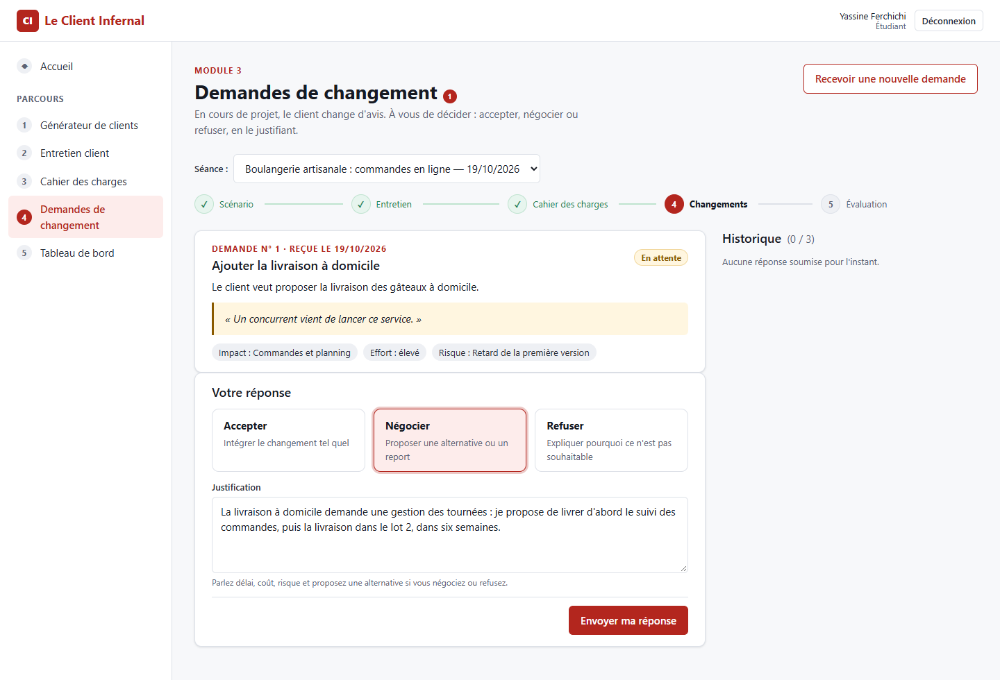
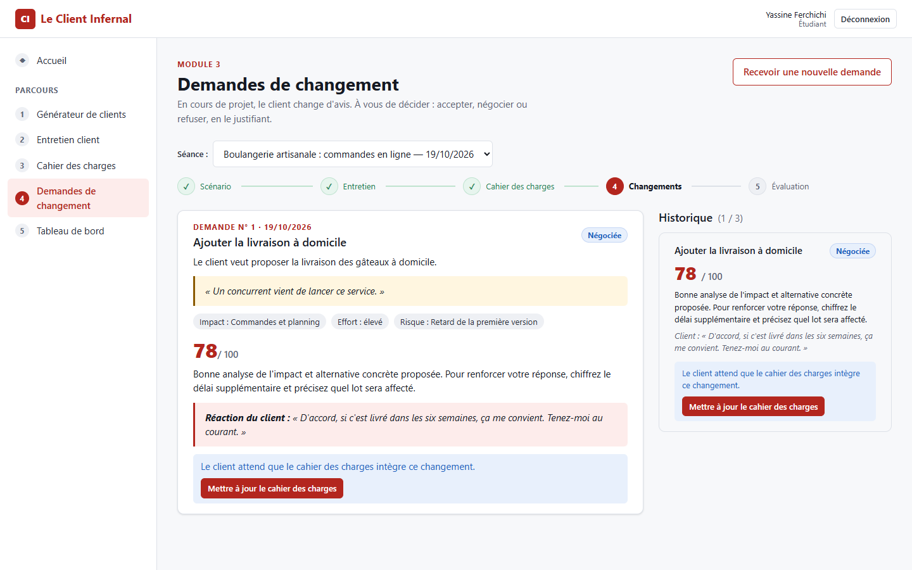
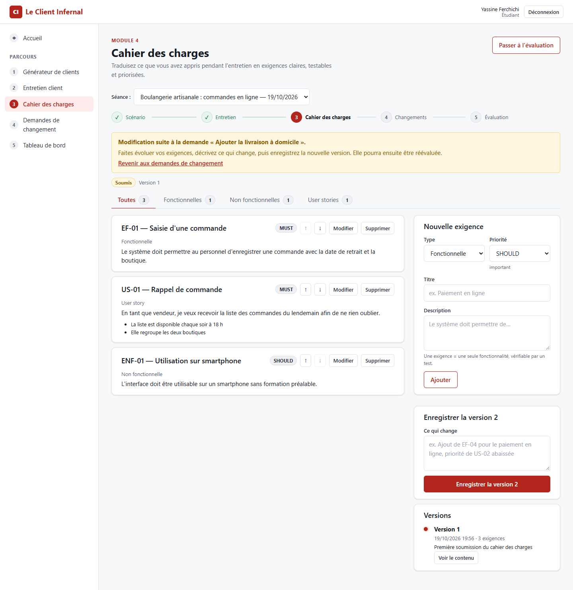
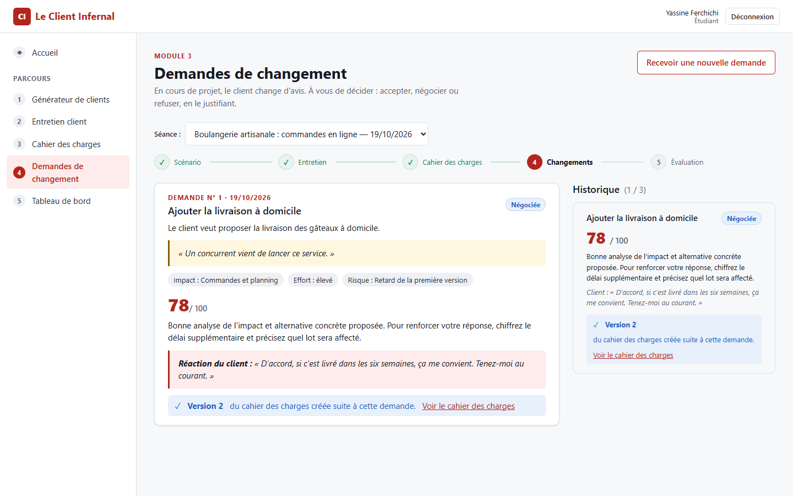
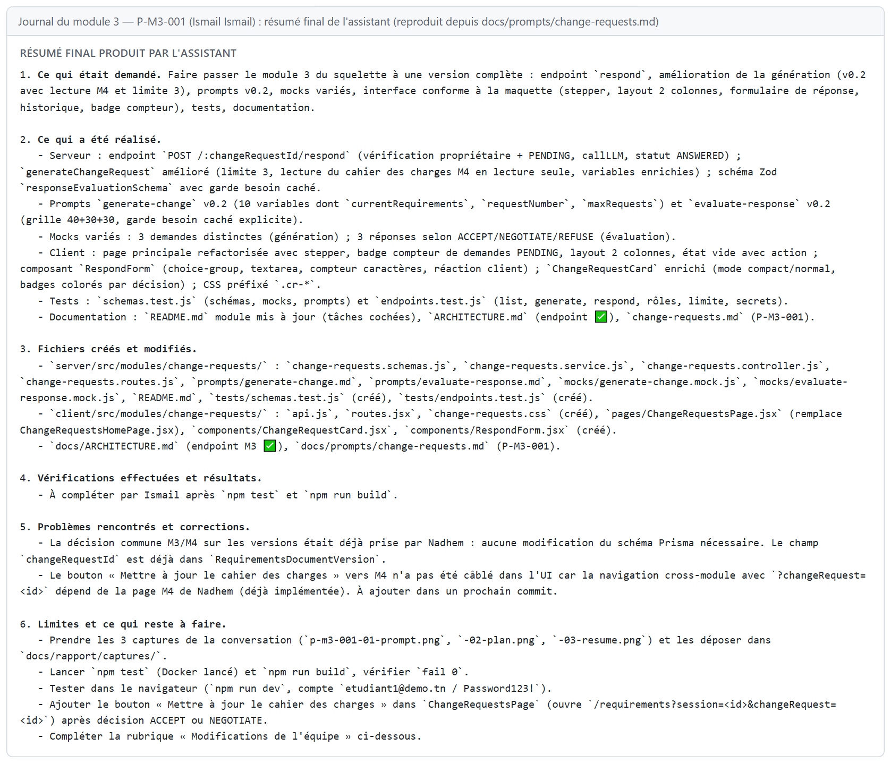

<!--
  Section 5.3 du rapport — module 3, responsable Ismail Ismail.
  Rédigée à partir du journal docs/prompts/change-requests.md (P-M3-001 par Ismail, P-M3-002 par le chef de projet).
  Converti en Word par « npm run rapport » : ne modifiez pas le .docx à la main.
  Captures à fournir par Ismail : p-m3-001-01-prompt.png, p-m3-001-02-plan.png, p-m3-001-03-resume.png.
-->
## 5.3 Module 3 — Demandes de changement

**Responsable :** Ismail Ismail · **Branche :** `feature/change-requests` · **Dossiers :** `server/src/modules/change-requests/`, `client/src/modules/change-requests/`

### Objectif et fonctionnalités

En cours de projet, un client change d'avis. Le module 3 simule ces **demandes de changement** : le LLM, dans le rôle du client, formule des demandes réalistes à partir du scénario et du cahier des charges déjà rédigé. L'étudiant doit **accepter, négocier ou refuser** chaque demande en justifiant sa décision ; le LLM évalue cette réponse et joue la réaction du client. Une demande acceptée ou négociée fait évoluer le cahier des charges du module 4, dont chaque **version** est conservée.

| Fonctionnalité | Réalisation |
|---|---|
| Génération des demandes | Prompt v0.2 : scénario, demandes précédentes et cahier des charges actuel (lecture du module 4) ; demandes réalistes, non répétées, adaptées au niveau |
| Limite | 3 demandes par séance (409 au-delà) |
| Notifications | Compteur des demandes en attente dans le titre, première demande en attente ouverte automatiquement |
| Réponse de l'étudiant | Choix exclusif accepter / négocier / refuser et justification d'au moins 20 caractères |
| Évaluation par l'IA | Note sur 100 (grille 40 + 30 + 30), retour pédagogique, réaction du client enregistrée ; une seule réponse par demande |
| Versions du cahier des charges | Après « Accepter » ou « Négocier » : bouton vers le cahier des charges du module 4, puis affichage « Version N créée suite à cette demande » |
| Rôles | L'étudiant propriétaire répond ; l'enseignant consulte en lecture seule |
| Mode sans clé API | 3 demandes simulées variées et une évaluation simulée adaptée à chaque décision |

Tableau : Fonctionnalités du module 3

| Méthode | Route | Rôle | Rôle de l'endpoint |
|---|---|---|---|
| GET | /api/change-requests/sessions/:sessionId | propriétaire ou enseignant | Liste des demandes de la séance (avec note, retour et réaction du client) |
| POST | /api/change-requests/sessions/:sessionId/generate | étudiant propriétaire | Génère la demande suivante ; 409 au-delà de 3 |
| POST | /api/change-requests/:changeRequestId/respond | étudiant propriétaire | Enregistre la décision, la fait évaluer par le LLM ; 409 si la demande a déjà reçu une réponse |

Tableau : Endpoints du module 3

Le module 3 **lit** les tables du module 4 (exigences et versions) mais n'y écrit jamais : c'est le module 4 qui crée la version, conformément à la décision commune prise avec son responsable et validée par le chef de projet.

### Prompts utilisés

| Prompt | Type | Rôle |
|---|---|---|
| P-M3-001 | Développement (Ismail, outil Antigravity) | Version complète du module : endpoint de réponse, génération v0.2, interface, tests, documentation |
| P-M3-002 | Développement (chef de projet, à l'intégration) | Lien avec les versions du module 4, protection réelle du besoin caché, réaction du client enregistrée, tests de bout en bout |
| generate-change.md | Système (application) | Génération d'une demande de changement ; v0.1 puis v0.2 |
| evaluate-response.md | Système (application) | Évaluation de la réponse de l'étudiant et réaction du client ; v0.1 puis v0.2 |

Tableau : Prompts liés au module 3

| Aspect | Prompts système v0.1 | Prompts système v0.2 (P-M3-001) |
|---|---|---|
| Contexte de la génération | Scénario et titres des demandes précédentes | En plus : cahier des charges actuel, numéro de la demande, limite de la séance |
| Grille d'évaluation | Pertinence 40, justification 30, communication 30 | Grille détaillée et consigne explicite de ne jamais citer le besoin caché |
| Réaction du client | Générée mais non enregistrée | Générée, validée et enregistrée (P-M3-002) |
| Validation Zod | Format seul | Format + refus d'un retour qui recopie le besoin caché ou une contrainte implicite (P-M3-002) |

Tableau : Évolution des prompts système du module 3

### Réalisation et captures

L'interface suit la maquette 07 du chapitre 4 : parcours de séance, carte de la demande avec la citation du client et son impact (périmètre, effort, risque), choix exclusif de la décision, justification, puis historique avec la note et la réaction du client.

Le bouton ouvre le cahier des charges du module 4 en mode « nouvelle version », lié à la demande :

Par rapport à la maquette 07, l'écran réalisé ajoute le compteur des demandes en attente, la limite de trois demandes et le lien avec les versions du cahier des charges.

### Tests

Le module est couvert par **38 tests automatisés** :

- schémas : décisions valides, justification trop courte, sortie du LLM ;
- protection du besoin caché : un retour ou une réaction du client qui recopie le besoin caché ou une contrainte implicite est refusé, accents et majuscules ignorés ; les réponses simulées passent la protection ;
- réponses simulées conformes au schéma et prompts v0.2 sans variable manquante ;
- endpoints sur une vraie base : authentification, rôles (403 pour l'enseignant et pour un autre étudiant), limite de 3 demandes (409), réponse déjà traitée (409), réaction du client conservée après rechargement, absence de secret dans toutes les réponses.

Les tests créent leurs propres séances et les suppriment à la fin, pour ne pas dépendre des autres modules dont les tests s'exécutent en parallèle.

Le parcours complet a aussi été vérifié dans un navigateur : réponse « Négocier » envoyée depuis l'interface, ouverture du cahier des charges depuis le bouton, création de la version 2, puis affichage de cette version dans le module 3.

### Difficultés et apport de l'IA

- **Travail réalisé par l'IA (P-M3-001)** : endpoint de réponse correct (propriétaire, réponse unique, validation Zod, données personnelles masquées), limite des demandes, lecture du cahier des charges du module 4, interface complète. Le prompt de départ étant détaillé, l'IA n'a posé aucune question.
- **Ce qui manquait à la livraison** : les tests n'avaient pas été exécutés, le lien avec les versions du module 4 n'était pas câblé, et la « protection du besoin caché » ne recherchait que les mots « besoin caché » : une évaluation pouvait recopier le contenu du besoin sans être refusée.
- **Corrections à l'intégration (P-M3-002)** : protection par comparaison de six mots consécutifs (même méthode que les modules 2 et 4), réaction du client enregistrée (elle disparaissait au rechargement), mise à jour conditionnelle contre la double réponse, bouton et affichage des versions, tests rendus indépendants des autres modules, suppression d'une page devenue inutile.
- **Leçon** : une fonctionnalité partagée entre deux modules (les versions) doit être testée de bout en bout, dans le navigateur, après la fusion ; et une protection de sécurité doit être vérifiée par un test qui tente réellement de la contourner.

> À compléter : ce qu'Ismail a vérifié, corrigé ou décidé lui-même (rubrique « Modifications de l'équipe » du journal).

### Limites et perspectives

- Les prompts v0.2 n'ont pas encore été évalués avec un vrai fournisseur (Claude ou OpenAI), faute de clé API.
- Les demandes simulées sont au nombre de trois et ne dépendent pas du domaine du scénario.
- La réaction du client n'influence pas encore la suite de la séance (par exemple une demande plus exigeante après un refus).
