## 5.4 Module 4 — Cahier des charges

**Responsable :** Nadhem Hmida · **Branche :** `feature/requirements` · **Dossiers :** `server/src/modules/requirements/`, `client/src/modules/requirements/`

### Objectif et fonctionnalités

Le module 4 permet à l'étudiant de traduire ce qu'il a appris pendant l'entretien en un cahier des charges structuré, puis de le faire évaluer par le LLM. Le LLM compare le document au **véritable besoin du client** (le besoin caché) et aux contraintes implicites, sans jamais les révéler : il note le travail selon une grille et propose des pistes. Le module conserve aussi les **versions successives** du cahier des charges lorsque le client formule une demande de changement (module 3).

| Fonctionnalité | Réalisation |
|---|---|
| Éditeur structuré | Trois types d'exigences (fonctionnelle, non fonctionnelle, user story), onglets par type avec compteurs ; ajout, modification, suppression et réordonnancement |
| Numérotation automatique | Codes EF-01, ENF-01, US-01 stables (plus grand numéro du type + 1), uniques, préfixe contrôlé par Zod côté serveur |
| Priorisation | MoSCoW (MUST, SHOULD, COULD, WONT) avec rappel de la signification de chaque niveau |
| Aide à la rédaction | Modèle « En tant que… je veux… afin de… », alerte si le format n'est pas respecté, critères d'acceptation pour les user stories, conseil adapté à chaque type |
| Soumission | Le brouillon est verrouillé et figé en version 1 ; il n'évolue ensuite que par une nouvelle version |
| Évaluation par l'IA | Prompt système v0.3, grille à 6 critères, réponse validée par Zod, note globale recalculée par le serveur, une évaluation par version, historique |
| Correspondance avec le besoin réel (P-M4-003) | Le LLM relie chaque point clé du besoin caché et chaque contrainte implicite aux exigences qui le traitent ; les deux notes de couverture sont calculées par le serveur à partir de cette correspondance |
| Versions successives | Nouvelle version après une demande de changement acceptée ou négociée (décision commune M3/M4) ; historique et consultation du contenu figé de chaque version |
| Rôles | L'étudiant propriétaire rédige ; l'enseignant consulte tout en lecture seule |
| Mode sans clé API | Évaluation simulée calculée à partir du contenu réel du cahier des charges |
Tableau : Fonctionnalités du module 4

| Méthode | Route | Rôle | Rôle de l'endpoint |
|---|---|---|---|
| GET | /api/requirements/sessions/:sessionId/document | propriétaire ou enseignant | Cahier des charges (créé vide au premier accès), statut et version courante |
| PUT | /api/requirements/sessions/:sessionId/document | étudiant propriétaire | Enregistre le brouillon ; 409 s'il est déjà soumis |
| POST | /api/requirements/sessions/:sessionId/document/submit | étudiant propriétaire | Soumet le brouillon et crée la version 1 |
| POST | /api/requirements/sessions/:sessionId/document/evaluate | étudiant propriétaire | Évalue la version courante en deux appels au LLM : correspondance avec le besoin réel, puis évaluation selon la grille |
| GET | /api/requirements/sessions/:sessionId/document/evaluations | propriétaire ou enseignant | Historique des évaluations |
| POST | /api/requirements/sessions/:sessionId/document/versions | étudiant propriétaire | Crée la version suivante après une demande de changement acceptée ou négociée |
| GET | /api/requirements/sessions/:sessionId/document/versions | propriétaire ou enseignant | Liste des versions, filtrable par demande de changement (utilisée par le module 3) |
| GET | /api/requirements/sessions/:sessionId/document/versions/:version | propriétaire ou enseignant | Contenu figé d'une version |
Tableau : Endpoints du module 4

Le document suit le cycle **Brouillon → Soumis (version 1) → Évalué**. Une demande de changement acceptée ou négociée permet d'enregistrer la version suivante, qui repasse au statut Soumis et peut être réévaluée. Le serveur vérifie lui-même la demande (même séance, réponse ACCEPT ou NEGOTIATE, pas déjà utilisée) : il ne se fie jamais au paramètre transmis dans l'URL.

Cette fonctionnalité touche deux modules et la base de données. Avant tout code, les responsables des modules 3 et 4 ont arrêté une solution commune, validée par le chef de projet : une table `RequirementsDocumentVersion` propriété du module 4 et seulement lue par le module 3, un champ `version` dans `RequirementsEvaluation`, et une seule migration (`ajout_versions_cahier`), livrée en premier dans un commit séparé pour débloquer le module 3.

### Prompts utilisés

Comme pour le module 1, deux types de prompts interviennent : le prompt de développement adressé à l'assistant (journal `docs/prompts/requirements.md`) et le prompt système utilisé par l'application.

| Prompt | Type | Rôle |
|---|---|---|
| P-M4-001 | Développement | Version complète du module : migration, serveur, interface, tests et documentation. Prompt de départ fourni par le chef de projet, complété par la décision commune M3/M4 |
| P-M4-003 | Développement | Système de correspondance (matching) par le LLM entre le besoin caché et les exigences |
| P-013 | Développement (base commune) | Fournisseur compatible OpenAI (`OPENAI_BASE_URL`) et test des prompts du module avec un vrai LLM (Gemini) |
| match-requirements.md | Système (application) | Correspondance entre les points du besoin réel et les exigences ; v0.1 |
| evaluate-document.md | Système (application) | Évaluation du cahier des charges selon la grille ; v0.1 (squelette), v0.2, puis v0.3 (reçoit la correspondance) |
Tableau : Prompts liés au module 4

| Aspect | v0.1 | v0.2 (P-M4-001) | v0.3 (P-M4-003) |
|---|---|---|---|
| Grille | 5 critères (couverture, contraintes, qualité, user stories, priorisation) | 6 critères conformes au tableau officiel : couverture du besoin réel (30), contraintes implicites (15), clarté et testabilité (20), absence d'ambiguïtés (15), user stories (10), MoSCoW (10) | Inchangée |
| Contexte fourni | Besoin exprimé, besoin caché, contraintes | En plus : niveau du scénario, numéro de version, demandes de changement intégrées | En plus : le résultat de la correspondance point par point |
| Notes de couverture | Données par le LLM | Données par le LLM | Calculées par le serveur à partir de la correspondance |
| Consignes de notation | Aucune | Comparer au besoin réel, exigence adaptée au niveau, commentaires qui citent les codes d'exigences | Inchangées |
| Protection du besoin caché | Consigne « ne cite jamais » | Exemples interdits et autorisés, et refus automatique par Zod d'un retour qui recopie le besoin caché | En plus : la correspondance ne contient aucun texte (identifiants, statuts, codes) |
| Validation Zod | Format seul | Critères et barème imposés, 1 à 4 pistes, note globale recalculée par le serveur | Un résultat par point, codes existants, statuts cohérents |
Tableau : Évolution du prompt système du module 4

Si l'évaluation recopie un passage du besoin caché ou d'une contrainte implicite (le texte entier ou six mots consécutifs, sans tenir compte des accents ni des majuscules), le schéma Zod la rejette et le service IA partagé relance l'appel : la consigne du prompt est doublée d'une vérification par le code.

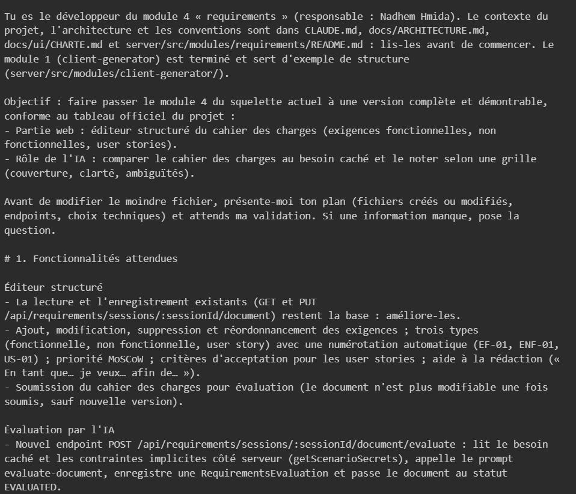
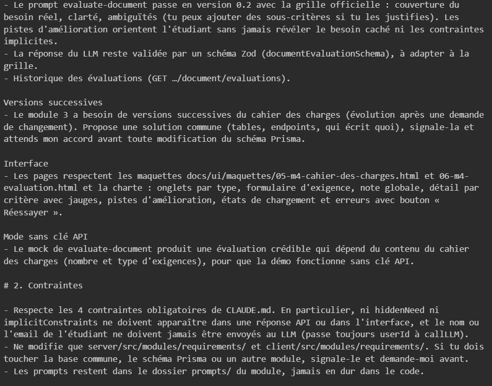
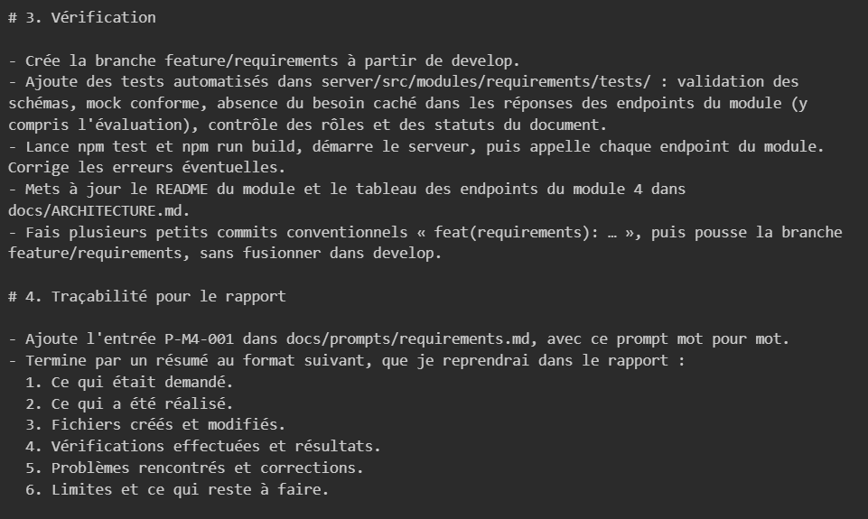

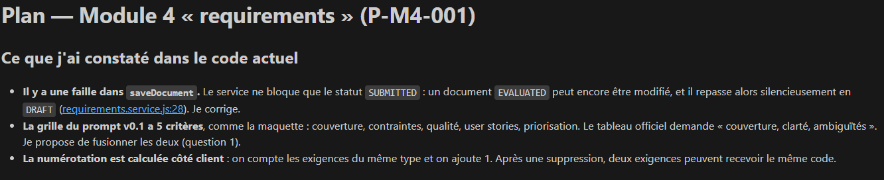
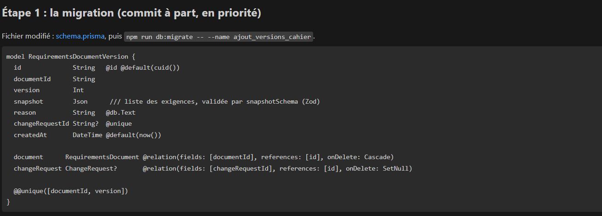
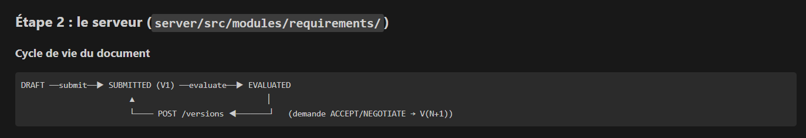
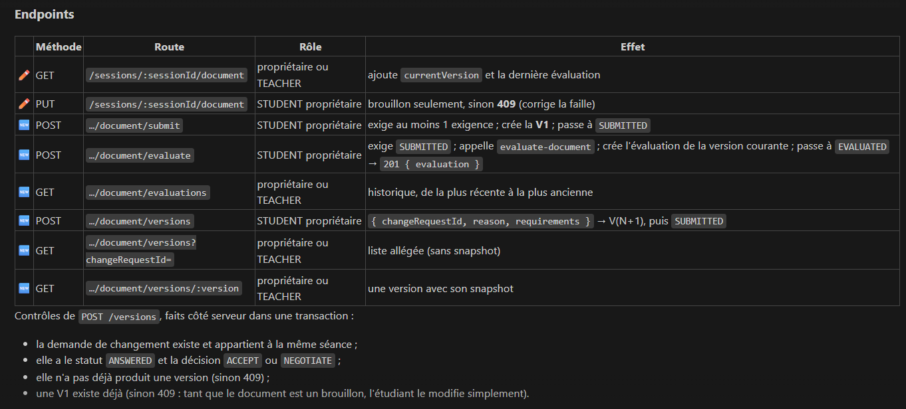
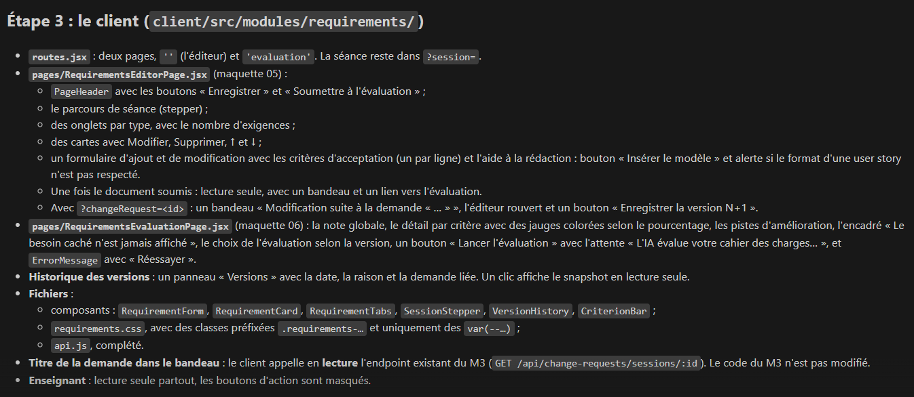
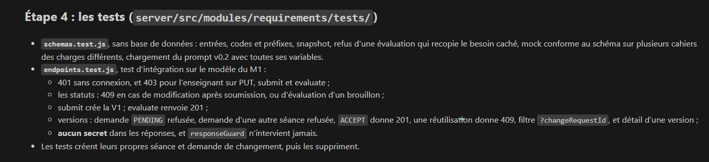
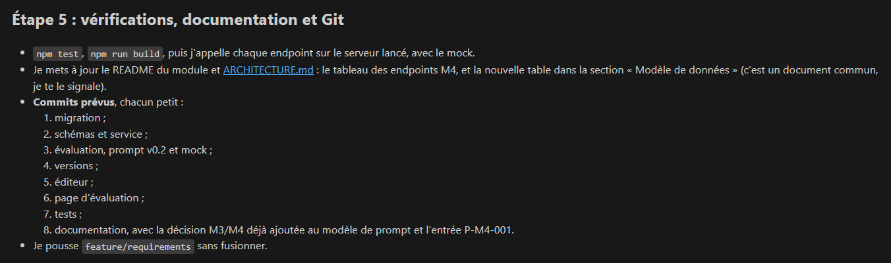

### Technique d'IA du cours appliquée

**Technique : Least-to-most (du facile au difficile)**, cours « Prompt Engineering » (p. 14 et 15), réalisée par Nadhem Hmida (P-M4-003). Le cours la définit ainsi : fragmenter un problème complexe en questions plus simples, examiner chaque segment séparément, puis fusionner les analyses en une réponse unifiée. Le prompt d'évaluation applique aussi le **Few-shot** (p. 20) avec ses exemples « Interdit / Autorisé » de pistes d'amélioration.

**Problème résolu.** La question « ce cahier des charges couvre-t-il le vrai besoin du client ? » est complexe : le LLM y répondait d'un seul bloc, par une note de couverture difficile à justifier. Rien ne montrait quel point du besoin était couvert, ni par quelle exigence.

| Étape du cours | Réalisation dans le module | Fichier |
|---|---|---|
| Décomposer | Le besoin caché est découpé en points N1, N2… (une phrase par point) ; chaque contrainte implicite devient un point C1, C2… | requirements.matching.js |
| Traiter chaque segment | Pour chaque point, le LLM répond à une question simple : est-il traité, partiellement traité ou absent, et par quelles exigences ? | prompts/match-requirements.md |
| Fusionner | Le serveur calcule les deux notes de couverture : 30 × (couverts + ½ partiels) / points N, et 15 × (même calcul) / points C | requirements.matching.js |
| Répondre | Le prompt evaluate-document v0.3 reçoit la correspondance et note les autres critères | prompts/evaluate-document.md |
Tableau : Le Least-to-most appliqué à l'évaluation du cahier des charges

La correspondance ne contient **aucun texte** : seulement des identifiants de points, des statuts, des codes d'exigences et une confiance. Rien du besoin caché ne peut donc en sortir. L'étudiant voit le nombre de points couverts (« 1 / 1 couvert ») sans leur contenu.

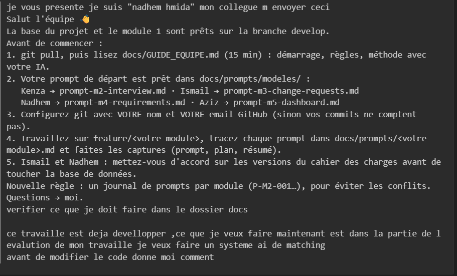

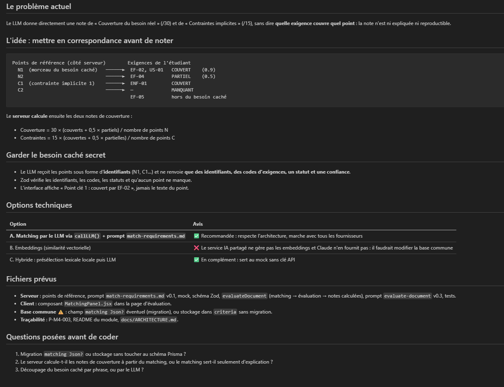

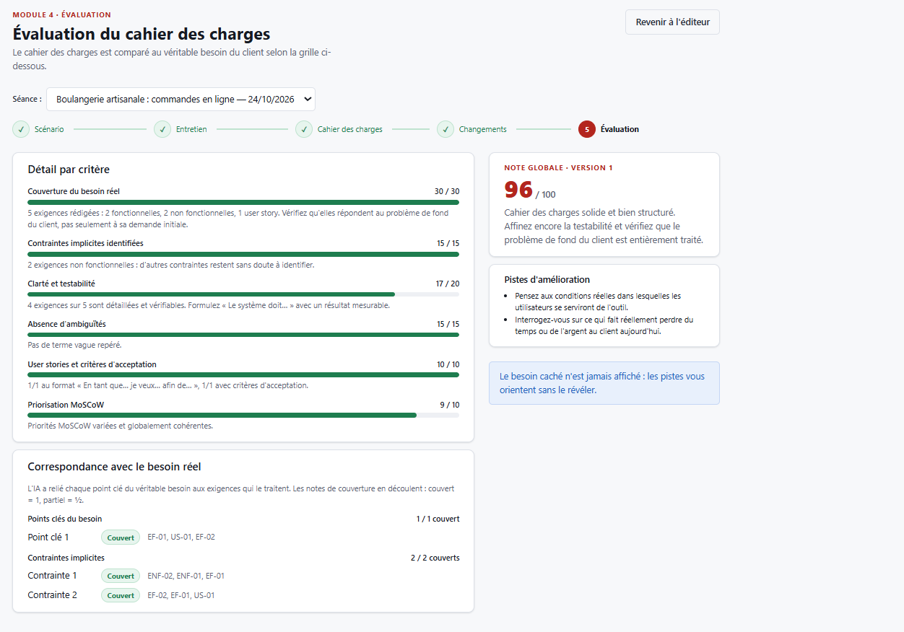

**Test avec un vrai LLM (P-013).** Nadhem a rendu le fournisseur `openai` compatible avec toute API au format OpenAI (variable `OPENAI_BASE_URL`), puis il a testé les prompts du module avec Gemini, sur des données fictives. Les réponses respectaient les schémas Zod et aucune n'a été refusée par le contrôle de fuite. La correspondance reconnaît des synonymes (« téléphone portable » couvre « smartphone »), ce que le mode simulé ne sait pas faire.

### Réalisation et captures

L'interface suit les maquettes 05 et 06 du chapitre 4 (figures 23 et 24) et la charte graphique : en-tête de page, parcours de séance, onglets par type, cartes d'exigences, formulaire à droite, puis note globale, détail par critère avec jauges et pistes d'amélioration. Les captures ci-dessous ont été prises sur l'application lancée en mode simulé, avec le scénario de démonstration « Boulangerie artisanale ».

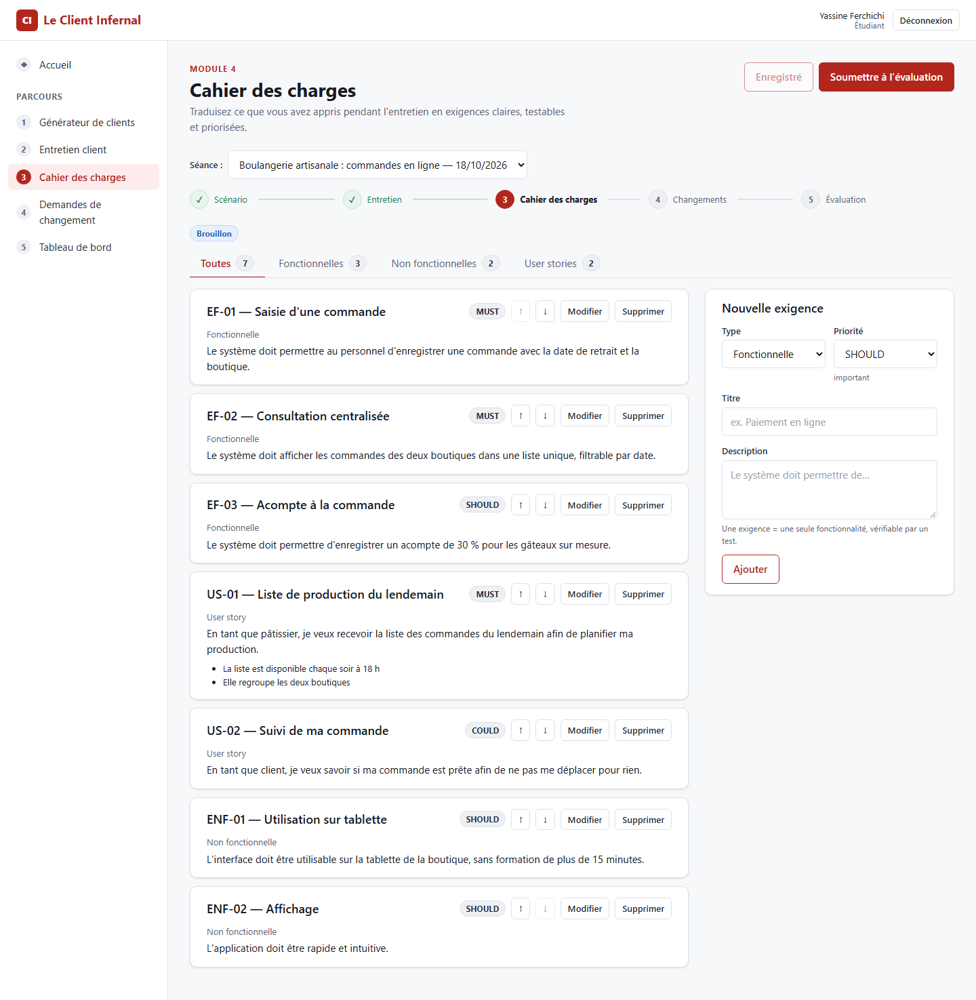

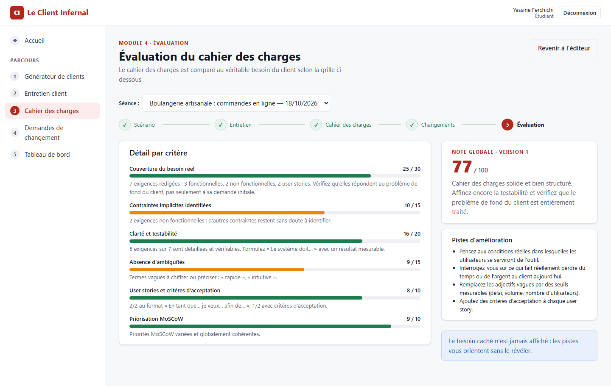

L'évaluation simulée réagit au contenu : par exemple, l'exigence ENF-02 « rapide et intuitive » fait perdre des points au critère « Absence d'ambiguïtés », et les pistes restent générales, sans révéler le besoin caché.

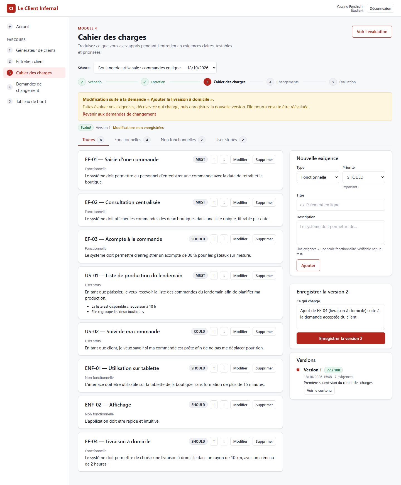

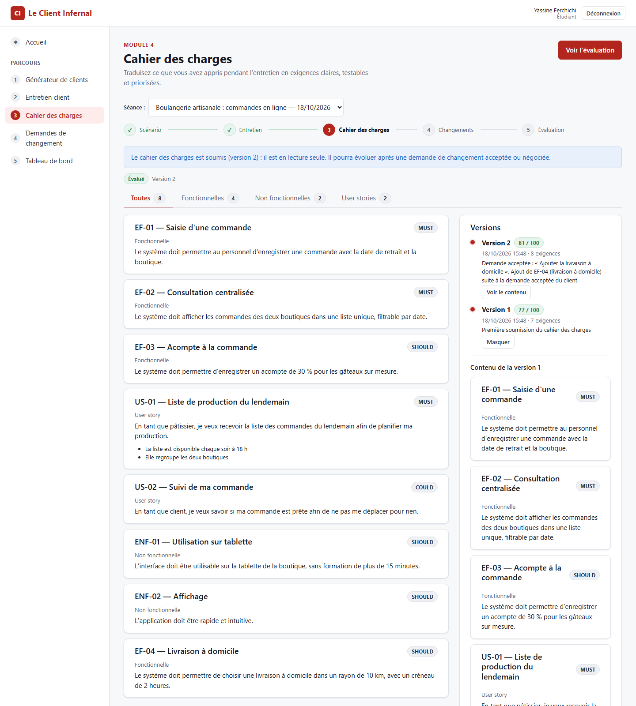

Par rapport à la maquette 05, l'écran réalisé ajoute le statut du document, les boutons de réordonnancement et de suppression, l'aide à la rédaction et l'historique des versions. La page d'évaluation reprend la maquette 06 avec six critères au lieu de cinq ; les jauges sont vertes à partir de 70 %, orange à partir de 50 % et rouges en dessous. Pour les figures 36 et 37, la demande de changement a été passée au statut « acceptée » directement en base, car la réponse aux demandes (module 3) n'était pas encore livrée.

### Tests

Le module est couvert par **37 tests automatisés** (26 avant la correspondance) :

- validation des schémas : préfixe du code cohérent avec le type, codes en double refusés, raison et contenu obligatoires pour une nouvelle version, numéro de version de l'URL contrôlé ;
- protection du besoin caché : une évaluation qui recopie le besoin caché ou une contrainte implicite est refusée, de même qu'un critère manquant ou une note supérieure au barème ;
- évaluation simulée conforme au schéma et croissante avec la qualité du document (vide, minimal, complet) ; prompts sans variable manquante ;
- correspondance (11 tests) : découpage du besoin en points, un résultat par point, pas de point inconnu ni en double, codes d'exigences existants, statuts cohérents, calcul des notes de couverture, résumé sans texte ;
- endpoints testés sur une vraie base : authentification, rôles (403 pour l'enseignant et pour un autre étudiant), statuts (409 pour une modification après soumission, l'évaluation d'un brouillon ou une double évaluation), versions (demande en attente, refusée ou d'une autre séance refusée ; une seule version par demande), et absence de `hiddenNeed` et `implicitConstraints` dans toutes les réponses.

Le serveur a aussi été lancé et ses 8 endpoints appelés (16 appels) : tous les codes de retour sont ceux attendus, aucune réponse ne contient de secret et le filet de sécurité `responseGuard` n'a jamais eu à intervenir.

### Difficultés et apport de l'IA

- **Faille dans le squelette** : l'enregistrement ne bloquait que le statut « soumis » ; un document déjà évalué pouvait être modifié et repasser en brouillon. L'IA l'a repéré en lisant le code existant et l'a corrigé (réponse 409).
- **Numérotation** : calculée côté client par comptage, elle pouvait attribuer deux fois le même code après une suppression. Les codes sont désormais stables et leur unicité est vérifiée côté serveur.
- **Relecture des captures** : en vérifiant les captures de ce rapport, l'IA a repéré une liste déroulante qui débordait du formulaire, des colonnes décalées (ordre de chargement des feuilles de style) et des accords incorrects dans l'évaluation simulée (« 2 exigence non fonctionnelles »). Ces défauts ont été corrigés avant l'insertion des captures.
- **Dépendance au module 3** : l'endpoint de réponse aux demandes de changement n'existant pas encore, la création des versions a été testée en modifiant la demande directement en base. L'intégration a depuis été validée de bout en bout, dans le navigateur (P-M3-002) puis lors de la campagne finale (chapitre 6).
- **Décisions humaines** : la solution commune M3/M4 (prise avec le module 3 et le chef de projet), la grille à six critères, l'enregistrement atomique d'une version avec ses exigences, des codes stables et une seule évaluation par version. Ces choix ont été proposés dans le plan de l'IA et validés par le responsable du module avant la génération.
- **Correspondance (P-M4-003)** : l'IA a proposé trois options, dont des embeddings, refusés parce qu'ils touchaient la base commune. Nadhem a retenu la correspondance par le LLM, sans migration : le résultat est joint aux deux critères de couverture, ce qui conserve le format lu par le module 5.
- **Vrai LLM (P-013)** : avec Gemini, un modèle trop lent dépassait le délai de 30 secondes ; le modèle « flash-lite » répond en 2 secondes environ. Un commentaire d'évaluation a donné un indice sur le besoin caché sans le recopier : le renforcement du prompt evaluate-document reste à faire.

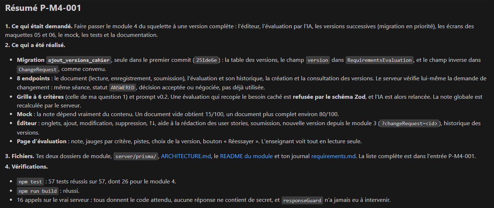
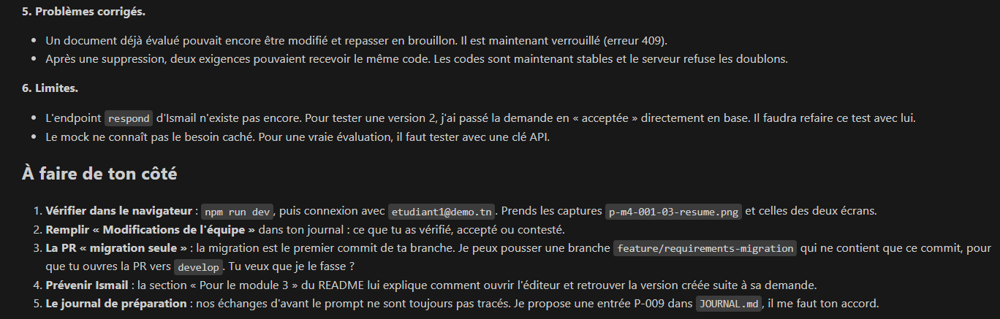

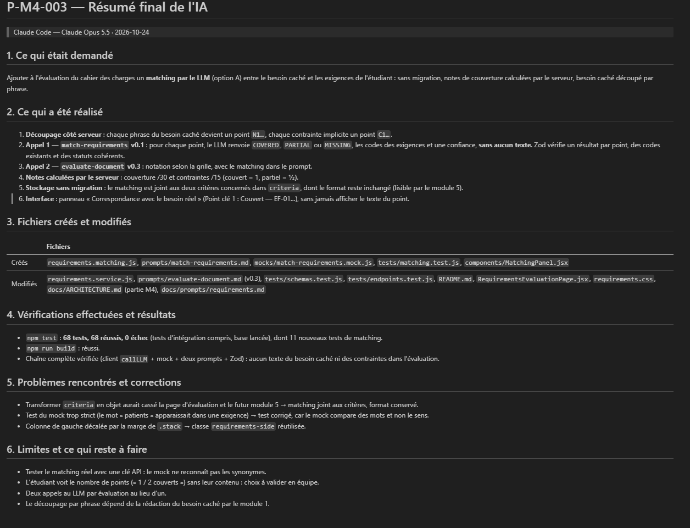

**Décisions du responsable du module**, consignées dans le journal :
- avant P-M4-001 : solution commune M3/M4 pour les versions, grille à six critères, codes stables, une seule évaluation par version ;
- dans P-M4-003 :
  - correspondance par le LLM (option A), plutôt que par embeddings, qui touchaient la base commune ;
  - résultat enregistré sans migration ;
  - notes de couverture calculées par le serveur ;
  - découpage du besoin caché par phrase ;
  - refus de lancer Docker pendant le développement ;
- dans P-013 : test avec un vrai LLM gratuit (Gemini), après le constat qu'un modèle trop lent dépassait le délai de réponse.

### Limites et perspectives

- Les prompts n'ont été testés avec un vrai LLM que sur Gemini : quelques cahiers des charges fictifs (P-013), puis une séance complète (P-016, section 6.4). Un cahier des charges hors sujet y a obtenu 0 sur 30 pour la couverture du besoin réel, comme attendu. Le commentaire orientait encore vers le besoin caché sans le recopier. L'offre gratuite a un quota par minute et par jour.
- En mode simulé, la correspondance compare des mots, pas le sens : un synonyme n'est pas reconnu.
- Chaque évaluation fait deux appels au LLM, et le découpage par phrase dépend de la rédaction du besoin caché par le module 1.
- Le contenu de l'entretien (module 2) n'est pas encore transmis au prompt d'évaluation, et deux versions ne peuvent pas être comparées visuellement (différences surlignées).

