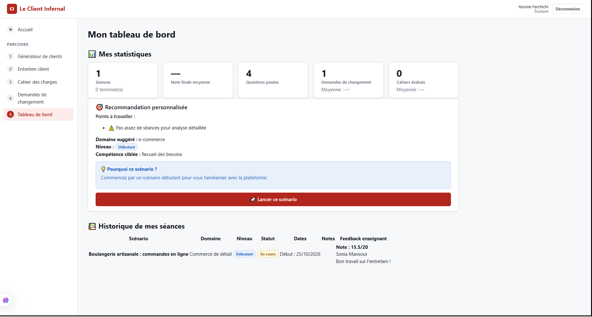
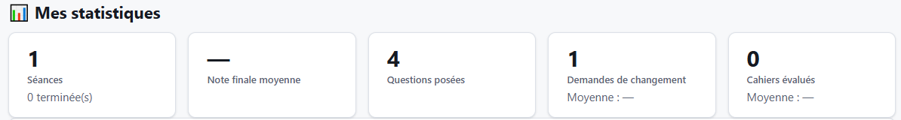
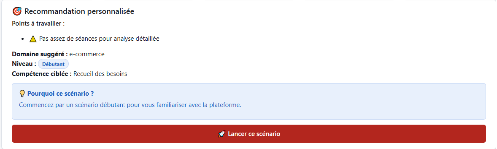
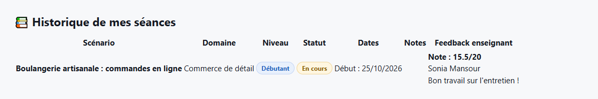
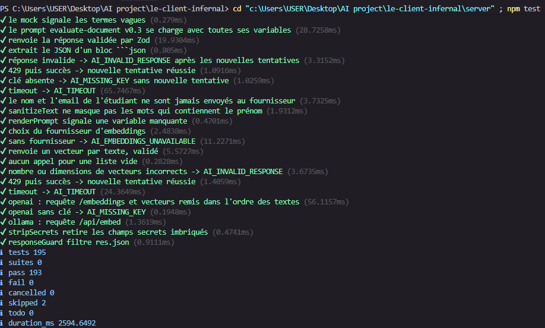

<!--
  Section 5.5 du rapport — rédigée par Aziz Louati.
  Ce fichier est converti en Word par « npm run rapport » : ne modifiez pas le .docx à la main.
  Modèle complet : section 5.1 (5.1-client-generator.md) et section 5.4 (5.4-requirements.md).
  Syntaxe : ### sous-titre · **gras** · `code` · - puce · | tableau | puis « Tableau : légende »
             · > À compléter : …
  Captures : déposez-les dans docs/rapport/captures/ (noms p-m5-NNN-NN-description.png).
-->
## 5.5 Module 5 — Tableau de bord

**Responsable :** Aziz Louati · **Branche :** `feature/dashboard` · **Dossiers :** `server/src/modules/dashboard/`, `client/src/modules/dashboard/`

### Objectif et fonctionnalités

Le module 5 « Tableau de bord » offre à l'étudiant une vue d'ensemble de sa progression et à l'enseignant un outil de suivi pédagogique. Il exploite l'IA pour analyser les performances passées et recommander le prochain scénario d'entraînement le plus adapté.

**Fonctionnalités réalisées**

| Fonctionnalité | Description | Utilisateur |
|---|---|---|
| Statistiques personnelles | Nombre de séances, note moyenne globale, questions posées, demandes de changement traitées, cahiers des charges évalués | Étudiant |
| Historique des séances | Liste complète des séances avec scénario, domaine, niveau, statut, dates, notes par module et feedback enseignant | Étudiant |
| Recommandation IA | Analyse des points faibles récurrents et suggestion du prochain scénario (domaine, niveau, personnalité, compétence à travailler) avec technique Few-shot | Étudiant |
| Vue d'ensemble enseignant | Statistiques globales (nombre d'étudiants, séances, appels IA), séances récentes de tous les étudiants | Enseignant |
| Fiche étudiant détaillée | Informations de l'étudiant, liste de ses séances avec notes et progression | Enseignant |
| Feedback enseignant | Ajout de commentaire et note sur une séance, visible par l'étudiant dans son historique | Enseignant |

**Endpoints implémentés**

| Méthode | Route | Rôle | Description |
|---|---|---|---|
| GET | `/api/dashboard/me/stats` | STUDENT | Statistiques de l'étudiant (séances, notes moyennes, compteurs) |
| GET | `/api/dashboard/me/history` | STUDENT | Historique complet des séances avec notes et feedback enseignant |
| GET | `/api/dashboard/me/recommendation` | STUDENT | Recommandation personnalisée du prochain scénario par l'IA (Few-shot) |
| GET | `/api/dashboard/teacher/overview` | TEACHER | Vue d'ensemble : statistiques globales, séances récentes, appels IA |
| GET | `/api/dashboard/teacher/students/:studentId` | TEACHER | Fiche complète d'un étudiant avec ses séances et sa progression |
| POST | `/api/dashboard/teacher/sessions/:sessionId/feedback` | TEACHER | Ajout d'un commentaire et d'une note sur une séance (table `TeacherFeedback`) |

### Prompts utilisés

**Prompts de l'IA assistant (journal)**

| Référence | Date | Description | Outil |
|---|---|---|---|
| P-M5-001 | 2026-10-25 | Création des tests complets du module (Phase 3) | Kiro — Claude Sonnet 4.5 |
| P-M5-002 | 2026-10-25 | Vérification finale et documentation (Phase 4) | Kiro — Claude Sonnet 4.5 |

**Prompts système du module**

| Prompt | Version | Rôle | Variables |
|---|---|---|---|
| `recommend-scenario.md` | v0.2 | Analyse l'historique anonymisé et recommande le prochain scénario (technique Few-shot avec 3 exemples) | `{{history}}` (JSON anonymisé : domaines, niveaux, scores) |

**Évolution du prompt système**

| Version | Date | Changements |
|---|---|---|
| v0.1 | Initial | Brouillon sans exemples, recommandation basique |
| v0.2 | 2026-10-25 | **Technique Few-shot** : ajout de 3 exemples (historique → recommandation), analyse en 2 étapes (1. repérer faiblesses, 2. recommander), instructions détaillées pour éviter la répétition des domaines |

Les captures des prompts envoyés à l'IA et des plans proposés se trouvent dans le journal `docs/prompts/dashboard.md`.

### Technique d'IA du cours appliquée

**Technique : Few-shot Learning (cours Prompt Engineering, p. 20)**

**Définition** : Le Few-shot learning consiste à fournir au modèle quelques exemples d'entrée-sortie pour calibrer sa compréhension de la tâche avant de traiter la requête réelle.

**Problème résolu** : Sans exemples, le modèle peut produire des recommandations génériques ou mal structurées. Les exemples lui montrent comment analyser les faiblesses (peu de questions, scores faibles, décisions inappropriées) avant de recommander un scénario ciblé.

**Extrait du prompt `recommend-scenario.md` v0.2**

Le prompt contient 3 exemples complets :

```
## Exemples

### Exemple 1
**Historique :**
[
  {"domain": "santé", "level": "BEGINNER", "finalScore": 45, 
   "interviewQuestions": 5, "requirementsScore": 40},
  {"domain": "e-commerce", "level": "BEGINNER", "finalScore": 50, 
   "interviewQuestions": 6, "requirementsScore": 48}
]

**Recommandation attendue :**
{
  "weaknesses": ["Entretien trop court", "Exigences incomplètes"],
  "domain": "finance",
  "level": "BEGINNER",
  "personality": "RESERVED",
  "focusSkill": "Découverte du besoin caché",
  "rationale": "Vos entretiens sont trop brefs (5-6 questions). 
   Essayez un client réservé qui demandera plus de questions 
   ouvertes pour révéler son vrai besoin."
}

### Exemple 2
[Étudiant performant → niveau supérieur]

### Exemple 3
[Étudiant qui accepte trop facilement → client exigeant]
```

**Comparaison avec et sans exemples**

| Aspect | Sans exemples (v0.1) | Avec exemples (v0.2, Few-shot) |
|---|---|---|
| Analyse | Recommandation directe | Analyse des faiblesses PUIS recommandation |
| Structure | Champs manquants ou incohérents | Structure conforme au schéma |
| Pertinence | Générique ("essayez ce domaine") | Ciblée (lien entre faiblesse et recommandation) |
| Personnalité | Souvent omise | Adaptée aux faiblesses (ex: RESERVED pour travailler les questions ouvertes) |
| Justification | Courte et vague | Concrète (cite les scores et comportements observés) |

**Limites**

- Les exemples couvrent 3 cas typiques, mais pas toutes les combinaisons possibles de faiblesses
- Le modèle peut parfois reproduire trop littéralement les exemples (surapprentissage)
- L'historique doit contenir au moins 2 séances pour une analyse pertinente
- Sans séance, le mock fournit une recommandation par défaut (débutant, domaine aléatoire)

### Réalisation et captures

**Espace étudiant — Dashboard complet**

L'interface respecte la maquette `08-m5-tableau-de-bord.html` et la charte graphique (palette de couleurs, typographie Roboto, espacement cohérent).


**Figure 1** : Vue d'ensemble du tableau de bord étudiant

**Section 1 : Statistiques personnelles**


**Figure 2** : Cinq cartes affichent les métriques clés (séances, note moyenne, questions, demandes de changement, cahiers des charges)

Chaque carte affiche un titre, une valeur principale et un complément d'information. Le composant `StatCard.jsx` utilise une icône distinctive par métrique.

**Section 2 : Recommandation personnalisée**


**Figure 3** : Carte de recommandation avec analyse des points faibles et suggestion ciblée

La recommandation s'appuie sur la technique **Few-shot** (3 exemples dans le prompt). Elle affiche :
- Les points faibles repérés (badge orange avec icône d'alerte)
- Le domaine suggéré
- Le niveau recommandé (badge coloré : bleu débutant, vert intermédiaire, rouge avancé)
- La compétence cible
- Une justification personnalisée (tutoiement)
- Un bouton « Lancer ce scénario » qui redirige vers le générateur avec les paramètres en URL

**Section 3 : Historique des séances**


**Figure 4** : Tableau complet avec scénario, domaine, niveau, statut, dates, notes et feedback enseignant

Le tableau affiche une ligne par séance avec :
- Titre du scénario + domaine (badge)
- Niveau (badge coloré)
- Statut (badge vert, orange ou gris)
- Dates de début et fin
- Notes par module (interview, requirements, change-requests) avec code couleur
- Feedback enseignant (auteur + commentaire + note)

Le composant `HistoryTable.jsx` gère les états vides et les erreurs.

**Comparaison avec la maquette**

| Élément | Maquette | Réalisation |
|---|---|---|
| Cartes de stats | 4 cartes | ✅ 5 cartes (ajout cahiers des charges) |
| Recommandation | Carte simple | ✅ Carte enrichie avec points faibles (Few-shot) |
| Historique | Tableau basique | ✅ Tableau complet avec badges, notes et feedback |
| Bouton "Lancer" | Maquette statique | ✅ Redirection vers le générateur avec paramètres |
| États de chargement | Non spécifiés | ✅ Loader + message d'erreur avec bouton Réessayer |

### Tests

Le module dashboard dispose de **53 tests automatisés** répartis en 3 fichiers (voir `server/src/modules/dashboard/tests/`).


**Figure 5** : Exécution de `npm test` — 193 tests passent, 0 échec (dont 53 pour le module dashboard)

**Répartition des tests**

| Fichier | Tests | Catégorie |
|---|---|---|
| `schemas.test.js` | 24 | Tests unitaires des schémas Zod et mocks |
| `endpoints.test.js` | 17 | Tests d'intégration des 6 endpoints |
| `security.test.js` | 12 | Tests de sécurité et contrôle d'accès |

**Tests des schémas et mocks (24 tests)**

- Validation des schémas de paramètres (`sessionParamsSchema`, `studentIdParamsSchema`)
- Validation du schéma de feedback enseignant (`teacherFeedbackBodySchema`) : commentaire, note, limites
- Validation du schéma de recommandation (`recommendationSchema`) : faiblesses, domaine, niveau, personnalité
- Conformité du mock `recommend-scenario` au schéma
- Intelligence du mock : détection des faiblesses, adaptation du niveau, évitement des domaines répétés, personnalité ciblée
- Construction du prompt Few-shot avec variables

**Tests d'intégration des endpoints (17 tests)**

- `GET /api/dashboard/me/stats` : authentification, statistiques de l'étudiant
- `GET /api/dashboard/me/history` : historique avec notes et feedback, refus si autre étudiant
- `GET /api/dashboard/me/recommendation` : recommandation conforme au schéma, historique anonymisé envoyé au LLM
- `GET /api/dashboard/teacher/overview` : vue d'ensemble, accès réservé à l'enseignant
- `GET /api/dashboard/teacher/students/:studentId` : fiche étudiant, accès réservé à l'enseignant
- `POST /api/dashboard/teacher/sessions/:sessionId/feedback` : création du feedback, validation des données, accès réservé à l'enseignant
- Vérification que le filet de sécurité `responseGuard` n'a jamais eu à intervenir

**Tests de sécurité (12 tests)**

- **Anonymisation** : aucune donnée personnelle (firstName, lastName, email) dans l'historique envoyé au LLM
- **Besoin caché** : `hiddenNeed` et `implicitConstraints` absents de toutes les réponses API
- **Contrôle des rôles** :
  - Un étudiant ne peut pas accéder à l'espace enseignant (`GET /teacher/overview`, `GET /teacher/students/:id`, `POST /teacher/sessions/:id/feedback`)
  - Un étudiant ne peut pas accéder aux données d'un autre étudiant (`GET /me/history`, `GET /me/recommendation`)
  - Un enseignant peut voir les données de tous les étudiants
- **Protection du responseGuard** : filtre automatique des champs secrets si un développeur oublie de les omettre

### Difficultés et apport de l'IA

**Ce que l'IA a bien fait**

1. **Structure complète en une seule itération** : L'IA a généré les 6 endpoints, le service avec historique anonymisé, les schémas Zod enrichis et le prompt Few-shot v0.2 en suivant le plan initial.

2. **Technique Few-shot correctement appliquée** : Les 3 exemples du prompt couvrent des cas typiques (débutant faible, intermédiaire fort, accepte trop facilement) et la structure en 2 étapes (analyse → recommandation) est respectée.

3. **Tests complets** : Les 53 tests couvrent tous les aspects (schémas, mocks, sécurité, intégration) et ont été créés en suivant le modèle du module interview.

4. **Sécurité respectée** : L'historique anonymisé est construit côté serveur (fonction `buildAnonymizedHistory()` dans le service), aucune donnée personnelle n'est envoyée au LLM.

5. **Mock intelligent** : Le mock `recommend-scenario.mock.js` analyse réellement l'historique fourni (scores, domaines, décisions) au lieu de renvoyer une réponse fixe.

**Ce qu'il a fallu corriger**

1. **Relations Prisma** : Erreur dans les noms de relations (`interviewSummary` au lieu de `summary`, `requirementsDocument` au lieu de `document`). Correction immédiate après le premier test.

2. **Syntaxe TypeScript** : Utilisation de `as any` dans un test (code JavaScript pur). Supprimé.

3. **Commit Git** : L'IA ne peut pas committer directement. Les commits ont été faits manuellement par le responsable du module.

**Décisions prises par l'équipe**

1. **Schéma enrichi** : Ajout du champ `weaknesses` (liste de 1 à 3 points faibles) et `personality` (optionnel) au schéma `recommendationSchema` pour améliorer la pertinence de la recommandation.

2. **Règle de recommandation simple** : Avant d'appeler le LLM, une règle simple est appliquée (si moyenne > 75 au niveau actuel → niveau supérieur). Le LLM affine ensuite avec l'analyse des faiblesses.

3. **Bouton "Lancer ce scénario"** : Redirige vers le générateur avec les paramètres en URL (`/client-generator?domain=...&level=...&personality=...`). Le module 1 n'a pas été modifié (à signaler au chef de projet si le préremplissage est souhaité).

4. **Graphiques** : Reportés à une version ultérieure (ajout de Recharts modifie `client/package.json`). Les statistiques textuelles suffisent pour la démo.

**Apport global de l'IA**

L'IA a permis de passer du squelette à un module complet et testé en 2 sessions de travail (Phases 1-2-3 puis Phase 4). La technique Few-shot a été correctement appliquée sans essai-erreur. La documentation a été structurée selon le modèle du projet.

### Limites et perspectives

**Limites actuelles**

1. **Tests avec un vrai fournisseur LLM** : Les tests utilisent le mock par défaut. La recommandation n'a pas été testée avec un vrai modèle (Claude, OpenAI) sur des historiques variés.

2. **Graphiques de progression** : Absents (nécessiteraient Recharts ou une autre bibliothèque). Les statistiques sont textuelles (cartes de métriques).

3. **Calcul de la note finale** : Le champ `TrainingSession.finalScore` n'est pas encore calculé (nécessite l'accord de toute l'équipe sur la pondération entretien / requirements / change-requests).

4. **Export CSV** : Absent (fonctionnalité enseignant). L'enseignant ne peut pas exporter la liste des étudiants ou des séances.

5. **Filtres enseignant** : Absents (filtrer par statut, niveau, domaine). L'enseignant voit toutes les séances récentes sans pouvoir les filtrer.

6. **Bouton "Lancer ce scénario"** : Redirige vers le générateur avec paramètres en URL, mais le module 1 ne les lit pas encore (préremplissage du formulaire à implémenter côté module 1).

7. **Historique vide** : Si l'étudiant n'a aucune séance, le mock renvoie une recommandation par défaut (débutant, domaine aléatoire). Une interface dédiée (message d'accueil) serait plus pertinente.

**Perspectives d'amélioration**

1. **Graphiques interactifs** : Ajouter Recharts pour visualiser l'évolution des notes dans le temps, la répartition par domaine, les compétences par module.

2. **Recommandation multi-critères** : Tenir compte du temps passé par séance, des abandons, de la répétition des erreurs dans les changements refusés.

3. **Filtres et export** : Permettre à l'enseignant de filtrer les séances (statut, niveau, domaine, étudiant) et d'exporter en CSV pour l'analyse externe.

4. **Comparaison avec la cohorte** : Afficher le rang de l'étudiant par rapport à la moyenne de la classe (avec anonymisation des autres étudiants).

5. **Tests avec un vrai LLM** : Valider la recommandation Few-shot sur 20-30 historiques variés et comparer avec une version sans exemples (v0.1).

6. **Personnalisation de la recommandation** : Laisser l'étudiant indiquer ses préférences (domaines d'intérêt, niveau souhaité) pour affiner la suggestion.

7. **Notification de nouveau feedback** : Alerter l'étudiant quand l'enseignant ajoute un commentaire sur une séance.
