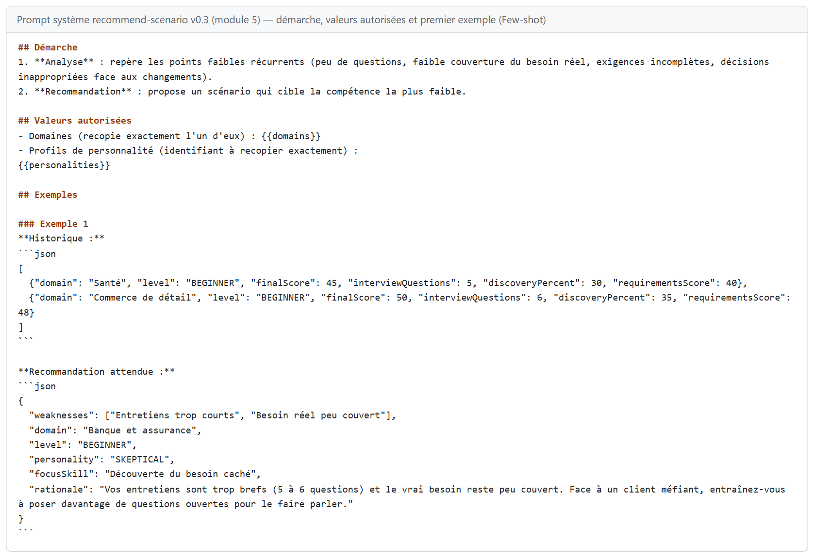
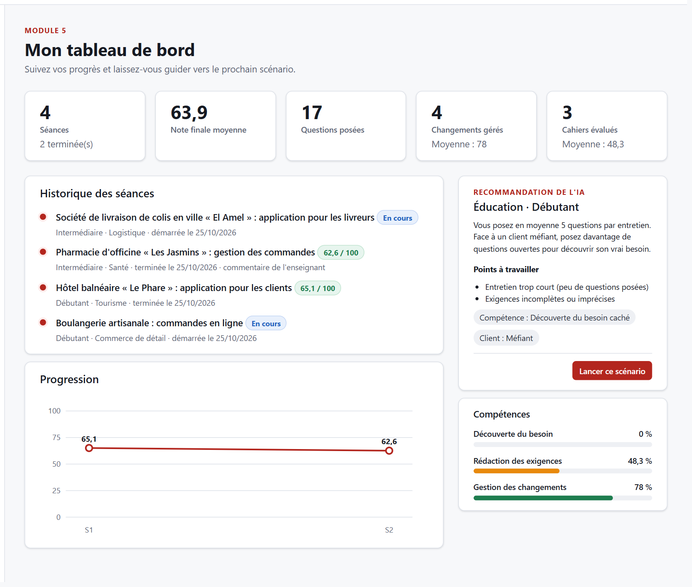
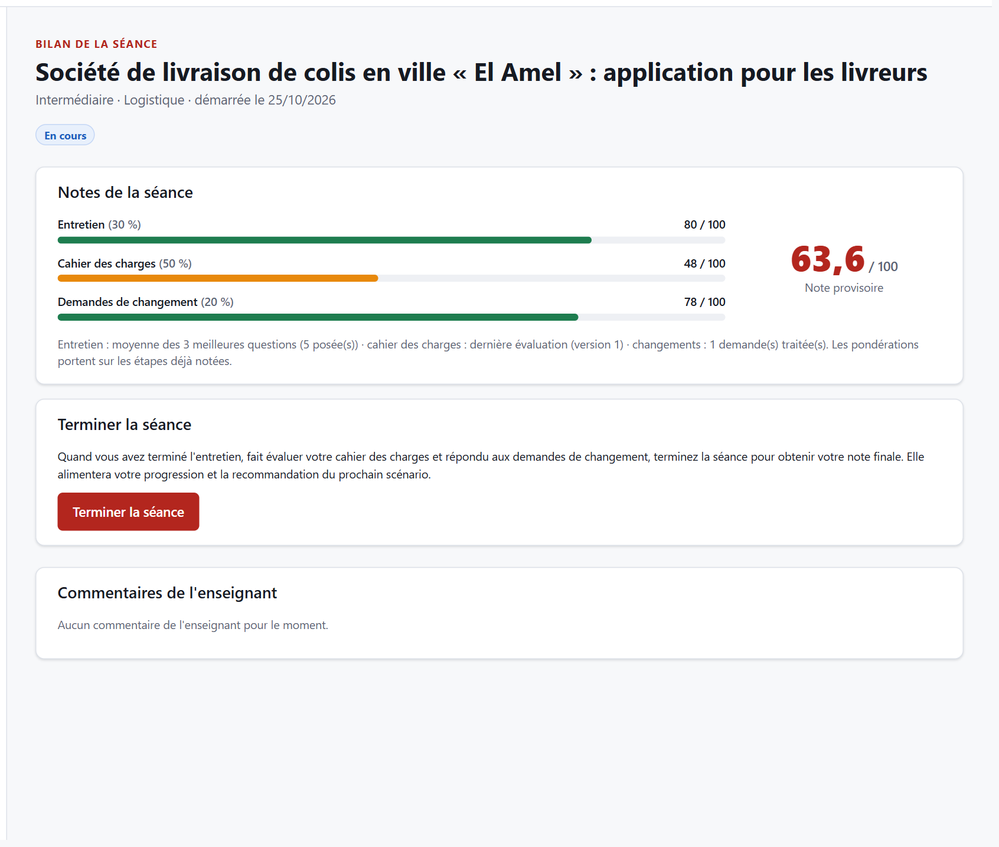
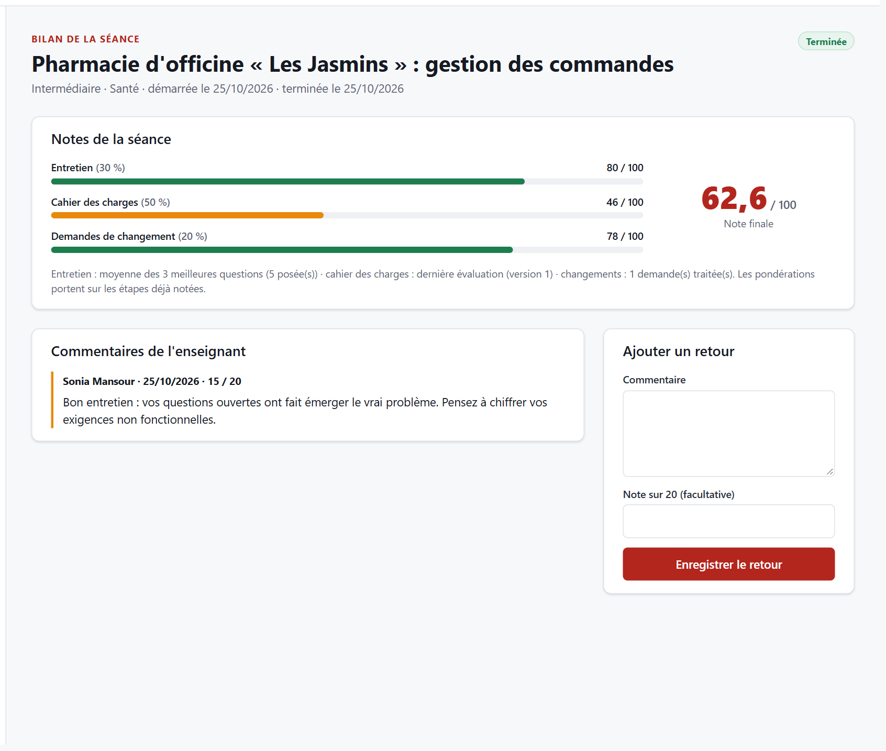
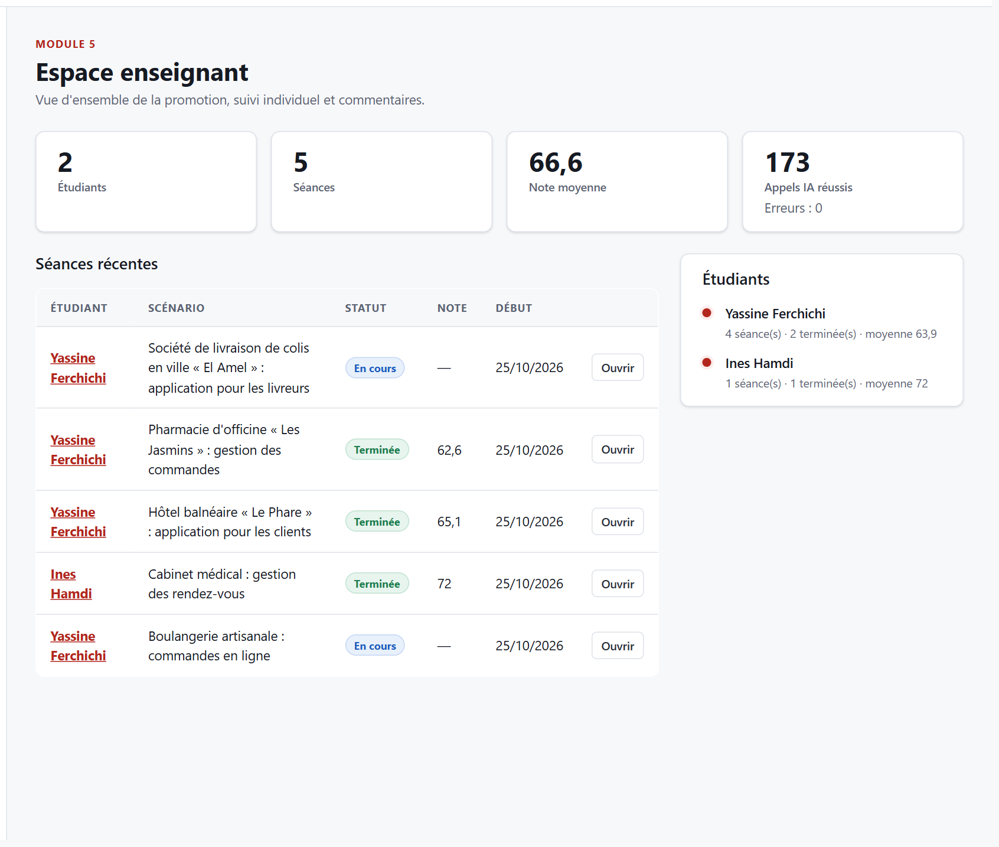
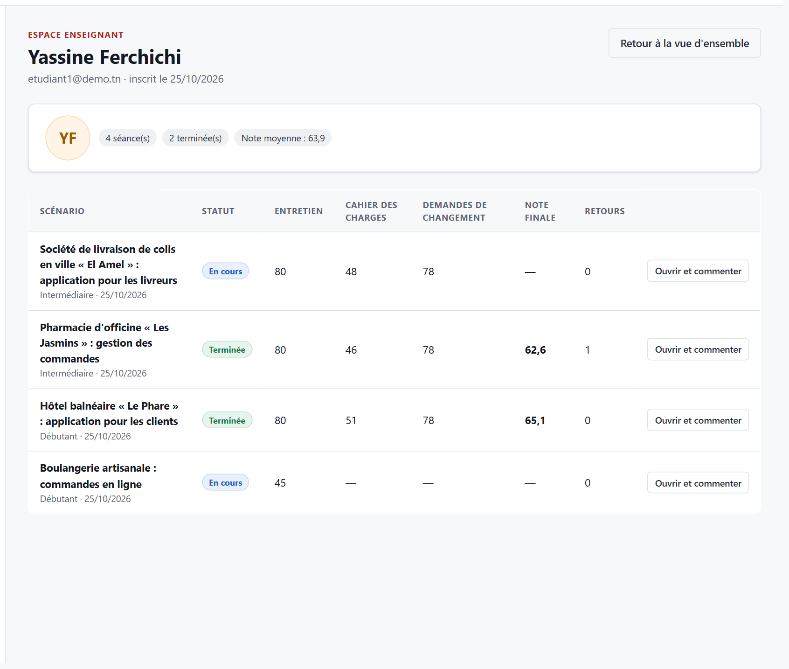

<!--
  Section 5.5 du rapport — rédigée par Aziz Louati (P-M5-002), mise à jour par Khalil Abdelmoumen (P-M5-003).
  Ce fichier est converti en Word par « npm run rapport » : ne modifiez pas le .docx à la main.
  Syntaxe : ### sous-titre · **gras** · `code` · - puce · | tableau | puis « Tableau : légende »
             · > À compléter : …
-->
## 5.5 Module 5 — Tableau de bord

**Responsable :** Aziz Louati · **Branche :** `feature/dashboard` · **Dossiers :** `server/src/modules/dashboard/`, `client/src/modules/dashboard/` · **Version :** 0.3

### Objectif et fonctionnalités

Le module 5 offre à l'étudiant une vue d'ensemble de sa progression et à l'enseignant un outil de suivi pédagogique. Il exploite l'IA pour analyser les performances passées et recommander le prochain scénario d'entraînement le plus utile. Il **lit** les tables des autres modules et n'écrit que dans la sienne (`TeacherFeedback`).

| Fonctionnalité | Réalisation | Utilisateur |
|---|---|---|
| Statistiques personnelles | Séances, note finale moyenne, questions posées, demandes de changement traitées, cahiers des charges évalués | Étudiant |
| Historique des séances | Chronologie des séances (scénario, niveau, domaine, statut ou note finale, commentaire de l'enseignant) avec accès au bilan | Étudiant |
| Progression | Graphique de la note finale de chaque séance terminée (SVG, sans bibliothèque externe) | Étudiant |
| Compétences | Découverte du besoin (critère « Couverture du besoin réel » du module 4), rédaction des exigences, gestion des changements | Étudiant |
| Recommandation par l'IA | Points faibles repérés, puis domaine, niveau, personnalité et compétence à travailler (technique Few-shot) ; bouton « Lancer ce scénario » qui pré-remplit le générateur du module 1 | Étudiant |
| Bilan de séance | Notes de l'entretien, du cahier des charges et des changements, note finale (provisoire puis définitive), bouton « Terminer la séance » | Étudiant, enseignant |
| Vue d'ensemble enseignant | Étudiants, séances, note moyenne, appels IA ; séances récentes et liste des étudiants | Enseignant |
| Fiche étudiant | Séances de l'étudiant avec la note de chaque étape et la note finale | Enseignant |
| Commentaires | Commentaire et note sur 20 sur une séance, visibles par l'étudiant dans son historique et son bilan | Enseignant |
Tableau : Fonctionnalités du module 5

| Méthode | Route | Rôle | Rôle de l'endpoint |
|---|---|---|---|
| GET | /api/dashboard/me/stats | étudiant | Statistiques, compétences et progression |
| GET | /api/dashboard/me/history | étudiant | Historique des séances avec les notes et les commentaires |
| GET | /api/dashboard/me/recommendation | étudiant | Recommandation du prochain scénario (IA, Few-shot) |
| GET | /api/dashboard/sessions/:sessionId/report | propriétaire ou enseignant | Bilan d'une séance : notes de chaque étape et note finale |
| GET | /api/dashboard/teacher/overview | enseignant | Vue d'ensemble, séances récentes et liste des étudiants |
| GET | /api/dashboard/teacher/students/:studentId | enseignant | Fiche d'un étudiant |
| POST | /api/dashboard/teacher/sessions/:sessionId/feedback | enseignant | Commentaire et note sur une séance |
Tableau : Endpoints du module 5

La fin de séance est assurée par l'endpoint commun `PATCH /api/sessions/:sessionId/status` (base commune, P-015) : il calcule la note finale, pondérée à 30 % pour l'entretien, 50 % pour le cahier des charges et 20 % pour les demandes de changement, et exige un cahier des charges évalué.

### Prompts utilisés

| Prompt | Auteur | Type | Rôle |
|---|---|---|---|
| P-M5-001 | Aziz Louati (Kiro) | Développement | Endpoints, prompt Few-shot v0.2 et tests du module |
| P-M5-002 | Aziz Louati (Kiro) | Développement | Vérification finale et documentation |
| P-M5-003 | Khalil Abdelmoumen (Claude Code) | Développement | Corrections à l'intégration, interface selon les maquettes, bilan de séance |
| recommend-scenario.md | — | Système (application) | Analyse l'historique anonymisé et recommande le prochain scénario ; v0.1, v0.2 puis v0.3 |
Tableau : Prompts liés au module 5

| Aspect | v0.1 (squelette) | v0.2 (P-M5-001) | v0.3 (P-M5-003) |
|---|---|---|---|
| Exemples | Aucun | 3 exemples « historique → recommandation » (Few-shot) | Les mêmes 3 cas, avec des domaines et des profils existants |
| Démarche | Recommandation directe | Points faibles d'abord, puis recommandation | Inchangée |
| Valeurs | Libres | Libres (exemples avec « RESERVED », « DEMANDING », « e-commerce ») | Domaines du module 1 et profils de personnalité fournis au modèle et imposés par Zod |
| Données | Historique anonymisé | Historique anonymisé (domaines, niveaux, notes, décisions) | En plus, la couverture du besoin réel (en %) |
| Ton | — | Tutoiement demandé, vouvoiement dans les exemples | Vouvoiement, comme le reste de l'application |
Tableau : Évolution du prompt système recommend-scenario

### Technique d'IA du cours appliquée

**Technique : Few-shot** (cours « Prompt Engineering », p. 20), choisie par Aziz Louati : le prompt montre au modèle 2 à 5 exemples d'entrée et de sortie plutôt que de lui décrire le résultat attendu. Le prompt demande aussi d'identifier les points faibles **avant** de recommander, et l'historique est anonymisé côté serveur, comme le recommande la checklist d'un prompt « safe » du cours (p. 34-35 : données anonymisées, séparer la logique des données).

**Problème résolu.** Sans exemples, un modèle produit une recommandation générique (« essayez un autre domaine »). Les 3 exemples lui montrent comment relier un constat chiffré à une recommandation ciblée :
- des entretiens trop courts mènent à un client méfiant, pour s'entraîner aux questions ouvertes ;
- de bons résultats mènent au niveau supérieur ;
- des changements toujours acceptés mènent à un client contradictoire, pour apprendre à négocier.

| Élément | Application | Vérification par le code |
|---|---|---|
| Few-shot | 3 exemples complets (historique JSON, puis recommandation JSON attendue) | Test : les 3 exemples sont présents dans le prompt construit |
| Analyse avant recommandation | Champ `weaknesses` rempli en premier | Zod : 1 à 5 points faibles obligatoires |
| Valeurs autorisées | Liste des 12 domaines et des 6 profils injectée dans le prompt | Zod : domaine et personnalité limités aux valeurs du module 1 |
| Anonymisation | `buildAnonymizedHistory()` : domaines, niveaux, notes, décisions ; aucun nom, email ni identifiant | Test unitaire : un historique contenant un nom, un email et des identifiants n'en transmet aucun |
| Règle sans IA | Moins de 2 séances terminées : règle simple, sans appel au LLM | Test : un étudiant avec une seule séance terminée reçoit la règle (`source: RULE`), un autre l'IA (`source: AI`) |
Tableau : Application de la technique Few-shot dans le module 5

**Une leçon sur le Few-shot.** En v0.2, les exemples utilisaient des profils (`RESERVED`, `DEMANDING`) et des domaines (« e-commerce », « industrie ») qui n'existent pas dans l'application. Or un modèle reproduit ce que montrent ses exemples. Le bouton « Lancer ce scénario » aurait alors envoyé au module 1 une personnalité qu'il refuse. La v0.3 corrige les exemples, fournit au modèle la liste des valeurs autorisées et fait vérifier ces valeurs par Zod. Les exemples guident le modèle, mais c'est le code qui garantit le résultat.

### Réalisation et captures

L'interface suit les maquettes 08 (tableau de bord) et 09 (espace enseignant) du chapitre 4 et la charte graphique, avec des styles propres au module (préfixe `db-`). Les captures montrent l'application à l'issue de la campagne finale (chapitre 6) : trois séances complètes, dont deux terminées.

| Élément de la maquette | Réalisation |
|---|---|
| Cartes de statistiques | 5 cartes (ajout des cahiers des charges évalués) |
| Historique en chronologie | Chronologie avec note finale ou statut, et lien vers le bilan |
| Recommandation | Carte de la maquette, enrichie des points faibles repérés par l'IA |
| Compétences | 3 barres calculées à partir des évaluations des modules 3 et 4 |
| Espace enseignant | Séances récentes, liste des étudiants, fiche étudiant, formulaire de retour |
| Non prévu dans la maquette | Graphique de progression, bilan de séance et fin de séance |
Tableau : Comparaison avec les maquettes 08 et 09

### Tests

Le module est couvert par **55 tests automatisés** : 25 tests unitaires (`schemas.test.js`), 21 tests d'intégration (`endpoints.test.js`) et 9 tests de sécurité (`security.test.js`). S'y ajoutent 6 tests de la base commune pour la fin de séance et la note finale (`server/tests/sessions.test.js`).

- schémas : paramètres, commentaire de l'enseignant (longueur, note sur 20), recommandation (points faibles, niveau, domaine et personnalité du module 1) ;
- mock : détection des points faibles, niveau supérieur pour un bon étudiant, domaine non encore pratiqué, personnalité adaptée, compétence ciblée ;
- prompt v0.3 : 3 exemples, valeurs autorisées injectées, aucune variable manquante ;
- endpoints, sur des séances de test créées puis supprimées :
  - statistiques, compétences et progression ;
  - historique et notes ;
  - recommandation par l'IA ;
  - bilan provisoire (52,5 attendu) ;
  - vue d'ensemble, fiche étudiant ;
  - commentaires (création, validation, 404 sur une séance ou un étudiant inconnu) ;
- sécurité :
  - historique anonymisé envoyé au LLM ;
  - besoin caché absent des 6 endpoints de lecture ;
  - rôles dans les deux sens ;
  - isolation entre étudiants ;
  - recommandation propre à chaque étudiant.

**Un test ignoré n'est pas un test réussi.** Au moment de la fusion, les 2 fichiers d'intégration d'Aziz ne s'exécutaient jamais. Leur préparation triait les séances par `createdAt`, un champ qui n'existe pas (c'est `startedAt`). L'erreur était interceptée et le test s'arrêtait avec le message « comptes de démonstration absents ». `npm test` affichait donc « 0 échec », avec 2 tests ignorés. Une fois ce champ corrigé, 12 tests sur 34 échouaient, car ils avaient été écrits pour une autre forme de réponse que celle du code. Ils ont été réécrits avec leurs propres données de test et ne sont plus jamais ignorés.

### Difficultés et apport de l'IA

**Travail d'Aziz Louati (P-M5-001, P-M5-002, avec Kiro)**
- 4 nouveaux endpoints avec contrôle des rôles ;
- un historique anonymisé construit côté serveur ;
- le schéma de recommandation enrichi des points faibles ;
- le prompt Few-shot v0.2 et ses 3 cas typiques ;
- un mock qui analyse réellement l'historique ;
- 25 tests unitaires et la documentation du module.

**Corrections à l'intégration (P-M5-003, Khalil Abdelmoumen, avec Claude Code)**
- Erreurs 404 : `new AppError('NOT_FOUND', message, 404)` inversait les arguments. Un étudiant ou une séance introuvable renvoyait une page d'erreur 500 au lieu d'une 404 JSON.
- Valeurs de la recommandation : domaines et profils limités à ceux du module 1 (voir « Une leçon sur le Few-shot »), et générateur du module 1 pré-rempli par le bouton « Lancer ce scénario ».
- Robustesse : la recommandation, qui appelle le LLM, se charge séparément. Un quota dépassé n'empêche plus d'afficher les statistiques et l'historique, et un bouton « Réessayer » est proposé.
- Note finale : aucune séance ne pouvait être terminée, donc la note finale restait vide et la recommandation ne pouvait jamais faire appel à l'IA. La règle de calcul et le bilan de séance ont été ajoutés (P-015).
- Interface : refaite selon les maquettes. Les classes CSS de type Bootstrap (`card-body`, `mt-3`…) n'existaient pas dans la charte. Les éléments manquants ont été ajoutés : graphique, compétences, fiche étudiant, formulaire de commentaire.
- Tests d'intégration : réécrits (voir « Tests »). Le test « aucune donnée personnelle envoyée au LLM » lisait un contenu que la table `AiCallLog` ne stocke pas, par conception : il est remplacé par un test direct de l'anonymisation.

### Limites et perspectives

- La recommandation n'a pas été testée avec un vrai fournisseur (Claude ou OpenAI), seulement avec le mock.
- La recommandation par l'IA demande au moins 2 séances terminées ; avant, une règle simple propose un premier scénario.
- La compétence « découverte du besoin » dépend du critère de couverture du module 4 : elle reste à 0 % tant que les cahiers des charges ne couvrent pas le vrai besoin, ce qui est voulu mais peut surprendre.
- L'export CSV et les filtres de l'espace enseignant ne sont pas réalisés.
- Perspectives : notification de nouveau commentaire, comparaison anonyme avec la promotion, recommandation tenant compte des abandons.
